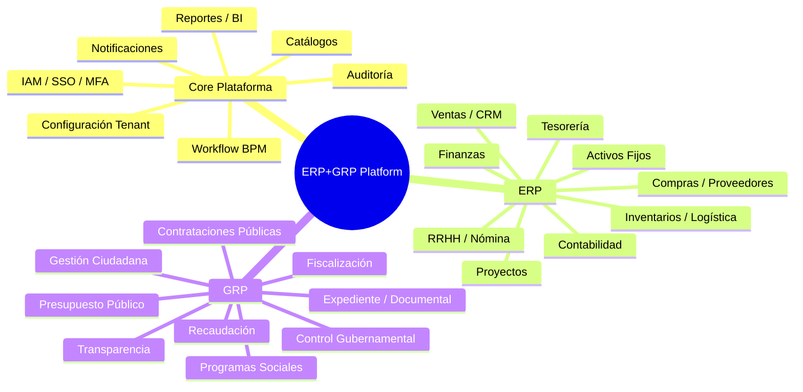
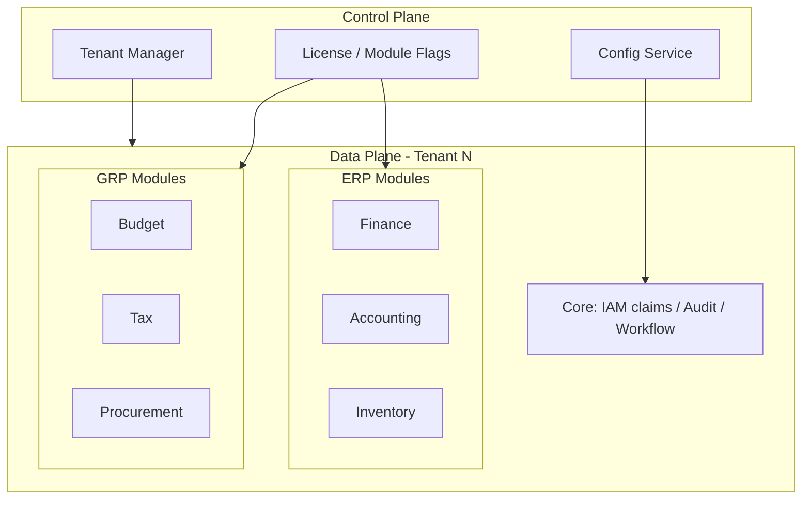
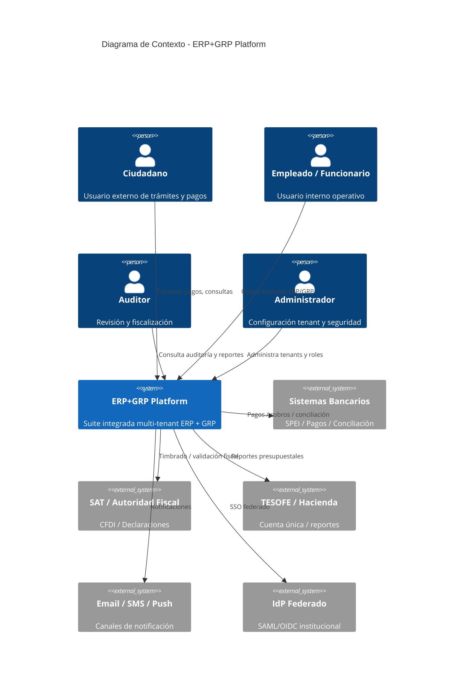

# Arquitectura Empresarial (Enterprise Architecture)

## 1. Mapa de capacidades de negocio



## 2. Vista de stakeholders

| Stakeholder | Canal | Necesidad |
|-------------|-------|-----------|
| Ciudadano | Portal / App | Trámites, pagos, transparencia |
| Capturista / Operador | Shell ERP | Captura transaccional |
| Jefe / Director | Dashboards | Aprobaciones, KPIs |
| Auditor interno/externo | Consola auditoría | Trazabilidad inmutable |
| Administrador TI | Consola tenant | Config, roles, módulos |
| Integradores | API Gateway | Bancos, SAT, TESOFE, nómina externa |
| Super Admin plataforma | Control plane | Tenants, licencias, observabilidad |

## 3. Arquitectura de valor (Value Streams)

1. **Procure-to-Pay (P2P):** Requisición → OC → Recepción → Factura → Pago → Contabilización → Afectación presupuestal.
2. **Order-to-Cash (O2C):** Cotización → Pedido → Entrega → Factura → Cobro → Contabilidad.
3. **Hire-to-Retire (H2R):** Reclutamiento → Alta → Nómina → Prestaciones → Baja.
4. **Budget-to-Report (B2R):** Anteproyecto → Aprobación → Liberación → Ejercicio → Cuenta Pública.
5. **Citizen-to-Service (C2S):** Solicitud → Expediente → Resolución → Notificación → Transparencia.

## 4. Modelo de tenancy



**Justificación:** Separar *Control Plane* (quién existe, qué módulos tiene) de *Data Plane* (transacciones) al estilo Oracle Fusion / SaaS Hyperscale. Permite onboarding de dependencias sin redeploy global.

### Estrategia multi-tenant elegida: **Hybrid**

| Capa | Estrategia | Motivo |
|------|------------|--------|
| Compute | Shared pods (tenant_id en JWT) | Densidad / costo |
| DB | Schema-per-tenant **o** shared schema + RLS (configurable) | Compliance variable |
| Kafka | Topics compartidos + header `tenantId` + ACLs | Throughput |
| Elasticsearch | Index alias por tenant | Aislamiento búsqueda |
| Object Storage | Prefijo `s3://bucket/{tenantId}/` | Documentos / expediente |

## 5. Modelo de módulos activables

```yaml
# Ejemplo configuración tenant
tenantId: dep-finanzas-estado-xyz
modules:
  erp:
    finance: true
    accounting: true
    treasury: true
    purchasing: true
    inventory: true
    hr: true
    payroll: true
    sales: false        # deshabilitado
    crm: false
  grp:
    budget: true
    tax: false
    procurement: true
    transparency: true
    citizen: true
    socialProgram: true
```

El **API Gateway** y el **Shell Angular** ocultan rutas/menús de módulos `false`. Los microservicios rechazan requests si el claim `modules` no incluye el dominio.

## 6. Diagrama de contexto C4 (Nivel 1)



> Nota: si el renderer Mermaid no soporta C4Context, usar el equivalente en `c4/context.mmd` (flowchart).
