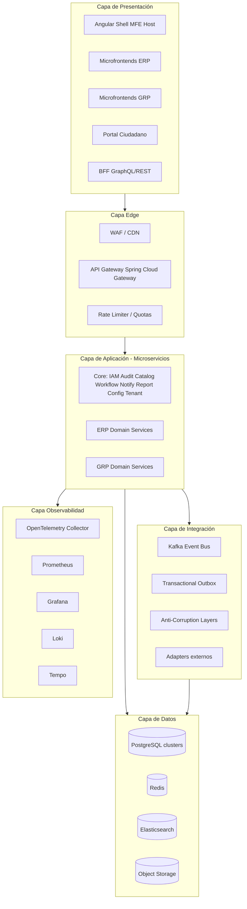
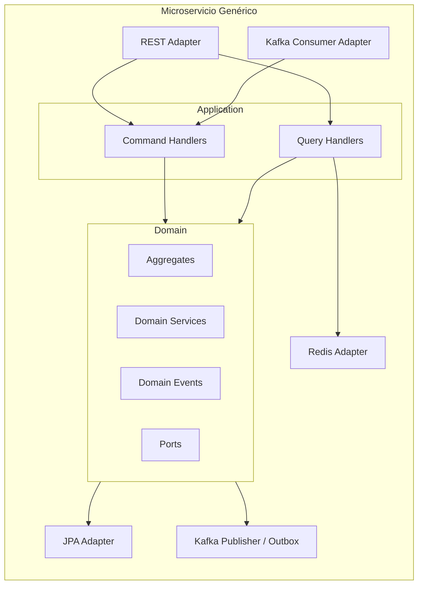

# Arquitectura Lógica

## 1. Capas lógicas



## 2. Patrón hexagonal por microservicio



**Justificación:** Homogeneiza el código entre 30+ servicios (como el “template” de SAP CAP / Spring Modulith extendido a microservicios). Reduce onboarding de equipos.

## 3. CQRS lógico

| Dominio | Write Model | Read Model | Motivo |
|---------|-------------|------------|--------|
| Accounting | `journal_entry` | `trial_balance_view`, ES ledger search | Consultas contables pesadas |
| Budget | `budget_allocation` | `budget_availability_mv` | Availability check en tiempo real |
| Payroll | `payroll_run` | `payslip_read`, report warehouse | Cálculo vs consulta masiva |
| Catalog | CRUD | Redis cache + ES | Alta frecuencia lectura |
| Citizen | Case aggregate | ES full-text expediente | Búsqueda ciudadana |

## 4. Paquete Java estándar (por servicio)

```
mx.gov.erpgrp.<contexto>/
  domain/
    model/          # Aggregates, Entities, VOs
    service/        # Domain services
    event/          # Domain events
    port/           # inbound/outbound interfaces
  application/
    command/
    query/
    handler/
  infrastructure/
    persistence/
    messaging/
    web/
    config/
    security/
  interfaces/
    rest/
    dto/
```

## 5. Cross-cutting concerns

| Concern | Implementación |
|---------|----------------|
| AuthN/AuthZ | JWT OIDC + method security + ABAC policies |
| Tenant resolution | `TenantContext` Filter (header/JWT claim) |
| Auditoría | AOP + Outbox → `audit-service` |
| Idempotencia | `Idempotency-Key` + Redis |
| Tracing | W3C Trace Context vía OTel |
| Resilience | Resilience4j (CB, retry, bulkhead, timelimiter) |
| Validation | Bean Validation + domain invariants |
