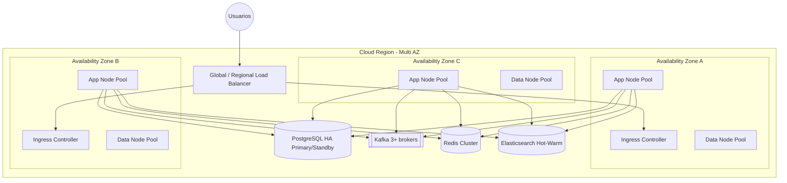

# Arquitectura Física

## 1. Topología multi-AZ (Producción)



## 2. Dimensionamiento de referencia (100k concurrentes)

| Componente | Spec base | Autoscaling |
|------------|-----------|-------------|
| API Gateway | 6–20 pods, 2 vCPU / 2Gi | HPA CPU 60% + RPS |
| iam-service | 8–30 pods | HPA + KEDA Kafka lag (login spikes) |
| finance / accounting / budget | 10–40 pods c/u | HPA memoria + RPS |
| Kafka | 6 brokers, RF=3, min.insync=2 | Particiones por dominio |
| PostgreSQL | Primary + 2 sync standbys (Patroni/Cloud SQL) | Read replicas para CQRS |
| Redis | 6 nodos cluster | Shard por tenant hash |
| Elasticsearch | 3 hot + 3 warm + 3 master | ILM policies |

**Justificación:** Cifras alineadas a workloads Dynamics/Oracle SaaS mid-tier; se ajustan con load tests (Gatling/k6) en UAT.

## 3. Redes y seguridad física/lógica

```
Internet → WAF/CDN → Public Ingress (TLS 1.3)
  → Service Mesh (mTLS) → Pods privados
  → Private Link a DB / Kafka / Redis
  → Egress controlado (allowlist SAT/Bancos)
```

- Segmentación: `dmz`, `app`, `data`, `mgmt`, `observability`.
- NetworkPolicies Kubernetes deny-by-default.
- Secrets en Vault / External Secrets Operator (nunca en Git).

## 4. Almacenamiento

| Tipo | Tecnología | Uso |
|------|------------|-----|
| Transaccional | PostgreSQL 16 | System of record |
| Caché / sesión / locks | Redis 7 | Sessions JWT denylist, rate limit, locks distribuídos |
| Búsqueda | Elasticsearch 8 | Expedientes, catálogos, auditoría full-text |
| Objetos | S3-compatible | Documentos, anexos, reportes |
| Eventos | Kafka + retención 30–365d | Integration + replay |
| Backups | PITR + snapshots diarios | RPO ≤ 15 min |

## 5. DR / BCP

| Métrica | Objetivo |
|---------|----------|
| RPO | ≤ 15 minutos |
| RTO | ≤ 1 hora |
| Estrategia | Warm standby región secundaria (async DB replica + MirrorMaker2 Kafka) |
| Pruebas | Chaos / failover trimestral documentado |
