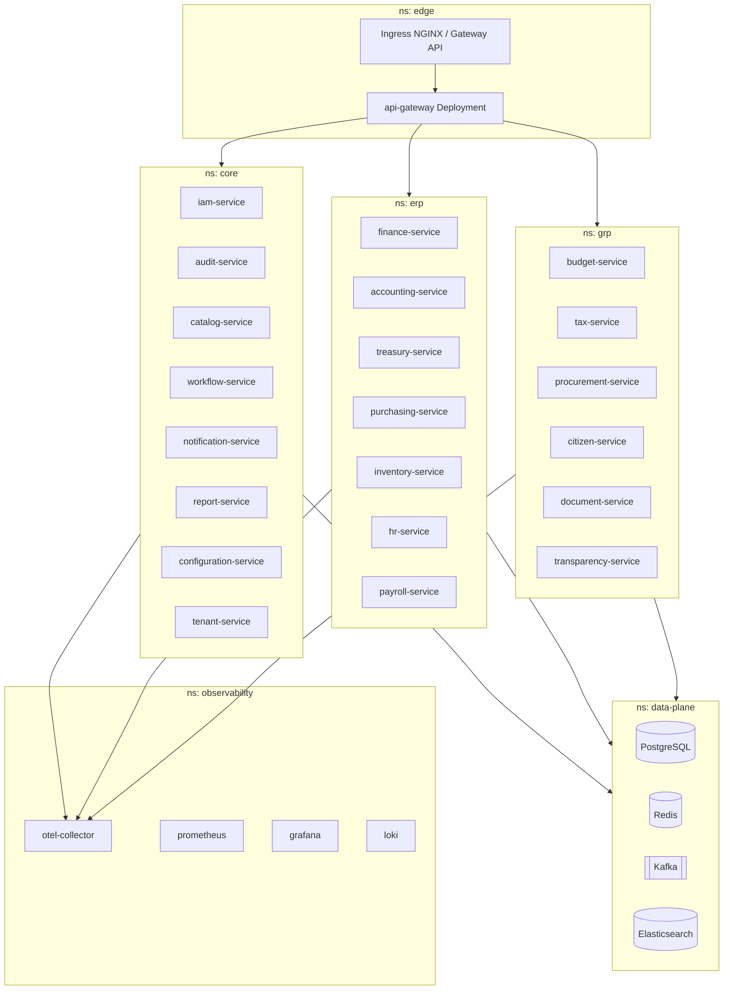
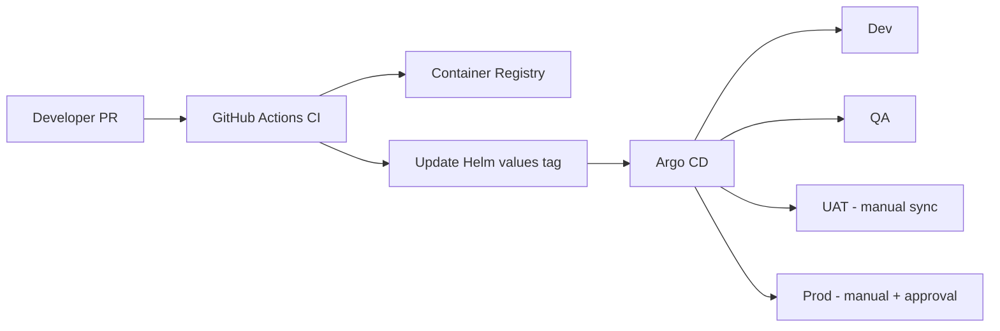

# Arquitectura de Despliegue

## 1. Entornos

| Entorno | Propósito | Datos | Escala |
|---------|-----------|-------|--------|
| Local | Dev laptop / docker-compose | Synthetic | Mínima |
| Dev | Integración continua equipos | Anonymized | Baja |
| QA | Pruebas funcionales / regresión | Seed + fixtures | Media |
| UAT | Aceptación negocio / carga | Producción-like | Alta |
| Prod | Operación real | Real + cifrado | Full HA |

## 2. Diagrama de despliegue Kubernetes



## 3. Estrategia de release

- **Rolling update** default (maxUnavailable=0, maxSurge=25%).
- **Blue/Green** para gateway e iam-service (críticos).
- **Canary** (Flagger / Argo Rollouts) 5% → 25% → 100% en Prod.
- **Feature flags** (configuración tenant) para módulos de negocio.

## 4. Empaquetado

```
Docker image: ghcr.io/org/erpgrp/<service>:<semver>
Helm chart: erp-grp/charts/<service>
Umbrella chart: infrastructure/helm/erp-grp
```

Cada servicio expone probes:

```yaml
livenessProbe:  GET /actuator/health/liveness
readinessProbe: GET /actuator/health/readiness
startupProbe:   GET /actuator/health/readiness
```

## 5. GitOps


