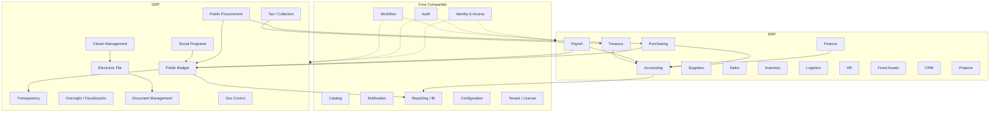

# Arquitectura de Dominios

## 1. Mapa de Bounded Contexts

## 2. Context Map (relaciones)

| Upstream | Downstream | Relación | Notas |
|----------|------------|----------|-------|
| IAM | Todos | OHS (Open Host Service) | JWT claims estándar |
| Catalog | Todos | OHS / Shared Kernel selectivo | Catálogos maestros |
| Workflow | Finance, Budget, Procurement, HR | Customer/Supplier | Motor de aprobaciones |
| Purchasing | Accounting, Budget, Inventory | Customer/Supplier | Eventos PO/GRN |
| Budget | Accounting, Procurement, Payroll | Conformist + ACL | Reglas de afectación |
| Accounting | Reporting | Customer/Supplier | Asientos publicados |
| Document | Electronic File, Transparency | Shared Kernel | Metadatos documento |
| Citizen | Tax, Social Programs | Customer/Supplier | Identidad ciudadana |

**Anti-Corruption Layers:**
- GRP Budget ↔ ERP Accounting (traduce *partida* ↔ *cuenta contable*).
- Public Procurement ↔ Purchasing (traduce *procedimiento* ↔ *orden de compra*).
- Tax ↔ Treasury (traduce *liquidación* ↔ *cobro/pago*).

## 3. Lenguaje ubicuo (extracto)

| Contexto | Término | Definición |
|----------|---------|------------|
| Accounting | Asiento / Journal Entry | Registro partida doble inmutable |
| Budget | Partida presupuestal | Rubro autorizado con techo |
| Budget | Compromiso / Devengado / Ejercido | Momentos contables presupuestales |
| Treasury | Cuenta bancaria / Conciliación | Control de liquidez |
| Procurement | Procedimiento de contratación | Licitación / adjudicación pública |
| Citizen | Expediente electrónico | Contenedor de actuaciones |
| Payroll | Incidencia | Evento que afecta cálculo de nómina |
| Audit | Hecho auditable | Mutación firmada e inmutable |

## 4. Agregados raíz (por dominio clave)

Ver detalle en `docs/domains/`. Resumen:

- **Finance:** `CostCenter`, `FinancialPeriod`, `ExchangeRate`
- **Accounting:** `ChartOfAccounts`, `JournalEntry`, `FiscalPeriod`
- **Budget:** `BudgetCycle`, `BudgetAllocation`, `BudgetMovement`
- **Purchasing:** `PurchaseRequisition`, `PurchaseOrder`, `GoodsReceipt`
- **Payroll:** `EmployeePayrollProfile`, `PayrollRun`, `Payslip`
- **Citizen:** `Citizen`, `ServiceRequest`, `CaseFile`
- **IAM:** `User`, `Role`, `PermissionPolicy`, `Session`
