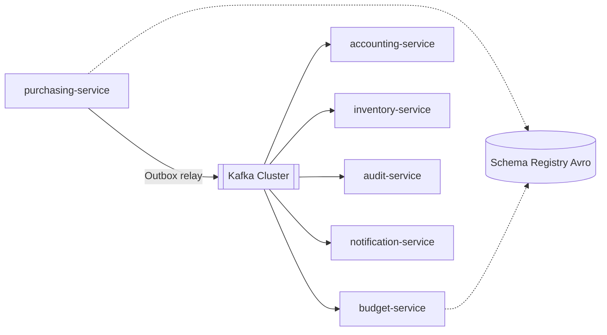
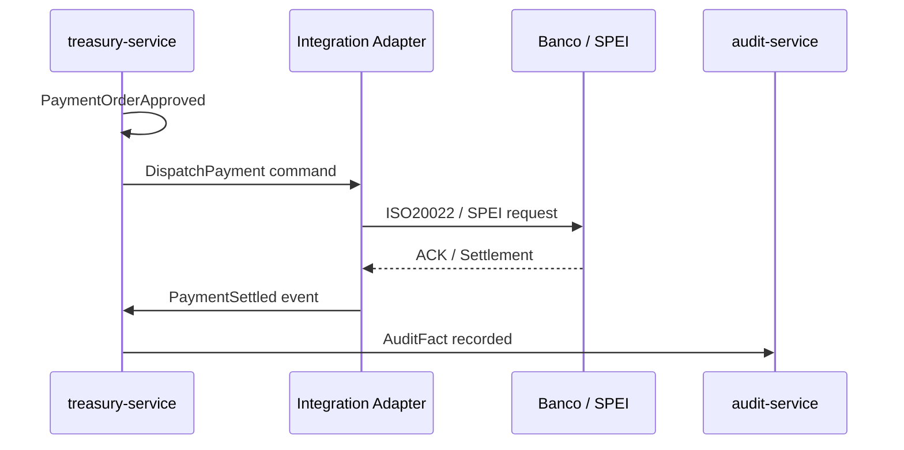

# Arquitectura de Integración

## 1. Patrones de integración

| Patrón | Uso | Ejemplo |
|--------|-----|---------|
| Sync REST/JSON | Queries y comandos UX | Crear OC, consultar saldo |
| Async Events (Kafka) | Side-effects entre dominios | `PurchaseOrderApproved` → Budget + Accounting |
| Outbox / Inbox | Consistencia dual-write | Persistencia + publicación atómica |
| Saga / Process Manager | Flujos largos | P2P, nómina, ejercicio presupuestal |
| ACL | Traducción ERP↔GRP | Partida ↔ Cuenta |
| BFF | Agregación UI | Shell Angular |
| File / Batch | Intercambios masivos | Layouts bancarios, CFDI zip |
| Webhooks | Extensibilidad partners | Notificar ERP externo |

## 2. Bus de eventos

## 3. Contratos

- **Síncronos:** OpenAPI 3.1 en `shared/openapi/<service>/v1.yaml`
- **Asíncronos:** Avro en `shared/avro/<domain>/*.avsc` + AsyncAPI
- **Versionado:** `major` breaking → topic nuevo o subject strategy `RecordNameStrategy` + compatibilidad BACKWARD

## 4. Integraciones externas

| Sistema | Protocolo | Seguridad |
|---------|-----------|-----------|
| Bancos | SFTP / API REST / MQ | mTLS + IP allowlist |
| SAT / CFDI | SOAP/REST | Certificados FIEL / CSD |
| TESOFE | Archivos / API | VPN + firma |
| IdP institucional | OIDC / SAML 2.0 | Metadata firmada |
| Email/SMS | SMTP / Provider API | API keys en Vault |

## 5. Idempotencia e integración confiable

1. Cada comando externo lleva `Idempotency-Key` (UUID).
2. Consumers Kafka usan `inbox` table `(consumer_id, event_id)`.
3. Reintentos con backoff exponencial + DLQ topic `*.dlq`.
4. Compensaciones explícitas en sagas (no 2PC distribuido).

## 6. Justificación vs ESB clásico

Los ESB monolíticos (Oracle SOA Suite / SAP PI legacy) se convierten en SPOF. Este diseño usa **smart endpoints, dumb pipes** (Kafka) al estilo Dynamics Dual-write + Azure Service Bus, con gobernanza de esquemas vía Schema Registry.
