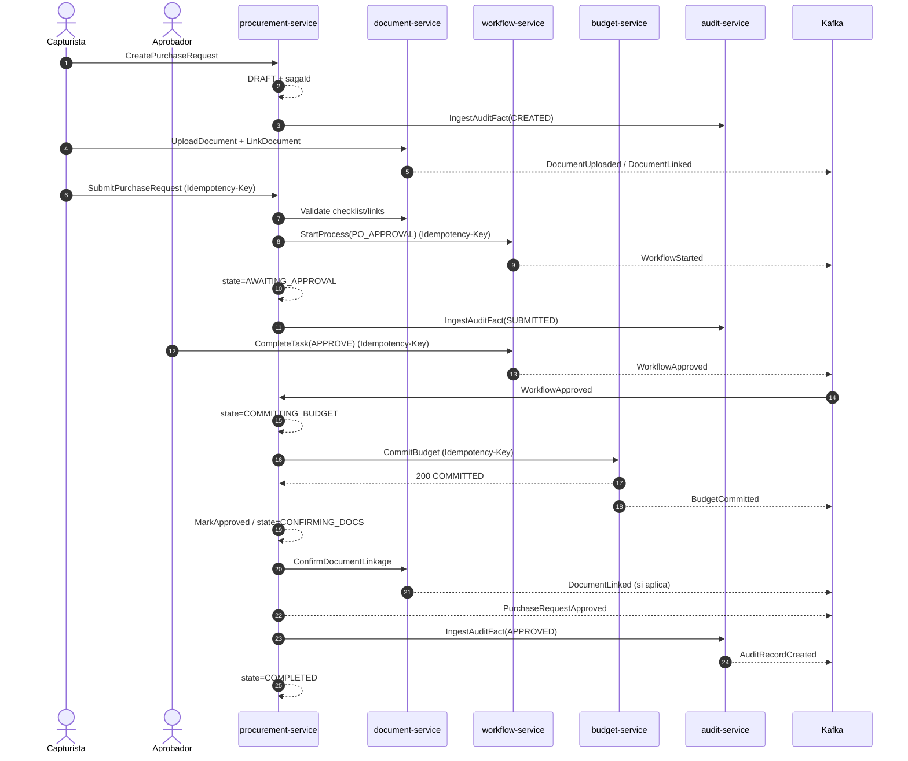
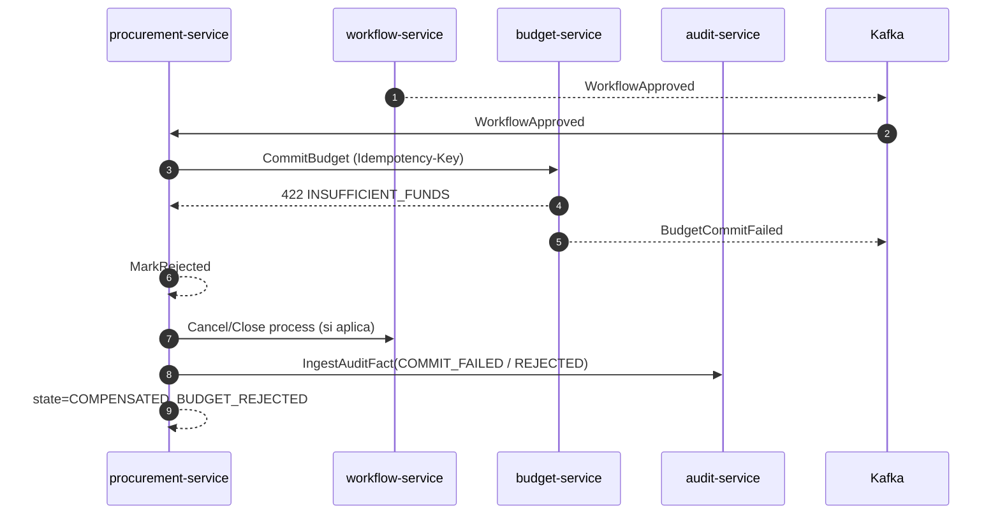
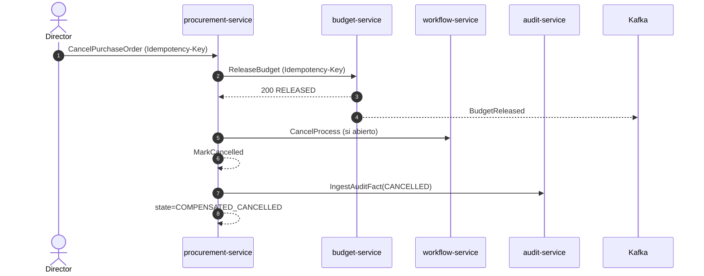
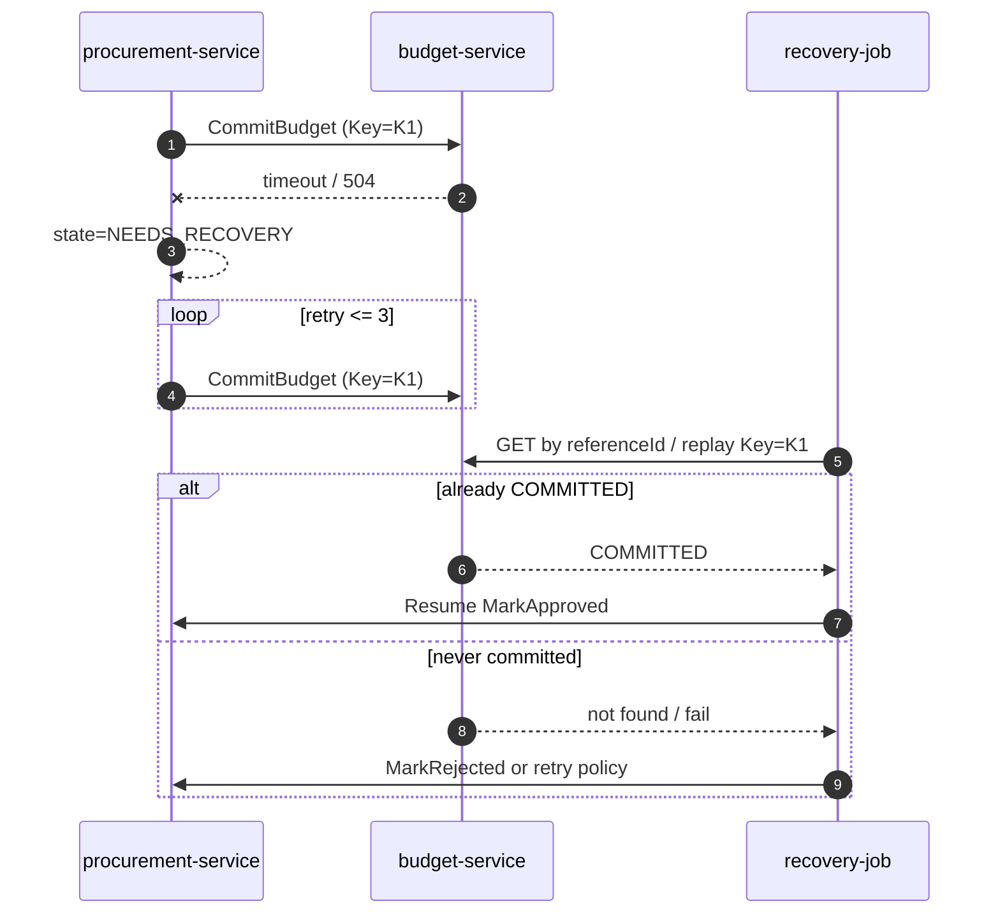
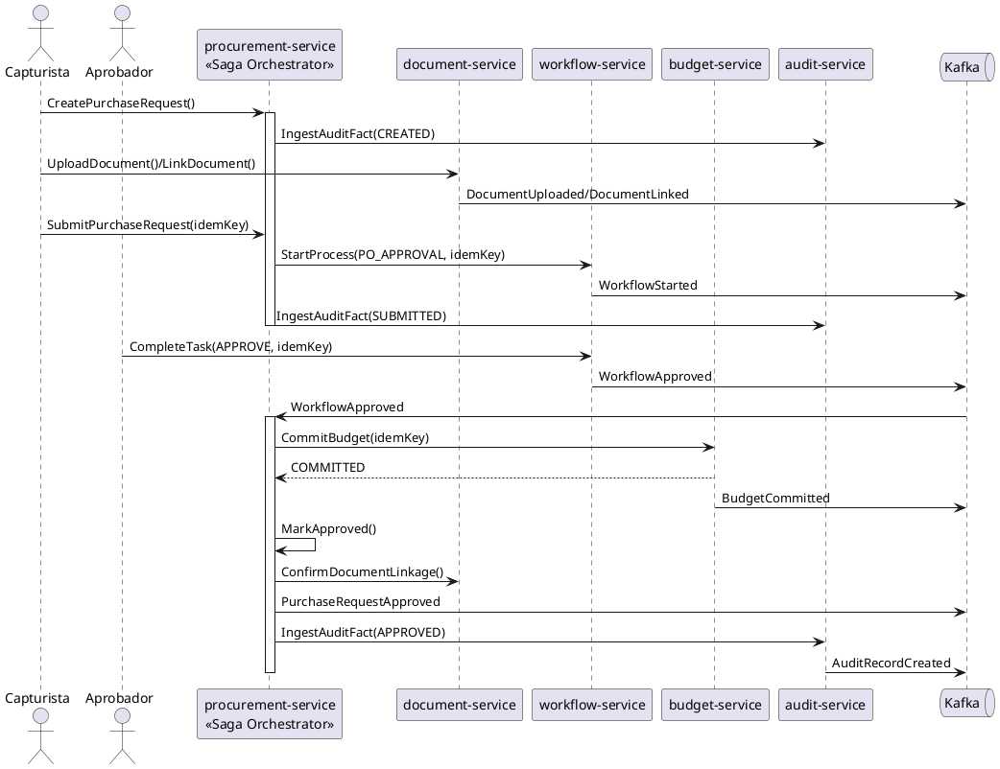
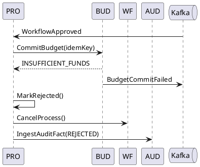

# 4. Diagramas de secuencia
## SAGA-MVP-001

## 4.1 Mermaid — Happy path (Budget aprobado)

## 4.2 Mermaid — Budget rechazado

## 4.3 Mermaid — Compensación post-commit (cancelación)

## 4.4 Mermaid — Timeout CommitBudget (estado desconocido)

## 4.5 UML Sequence (PlantUML) — Happy path

## 4.6 UML Sequence (PlantUML) — Budget rechazado

