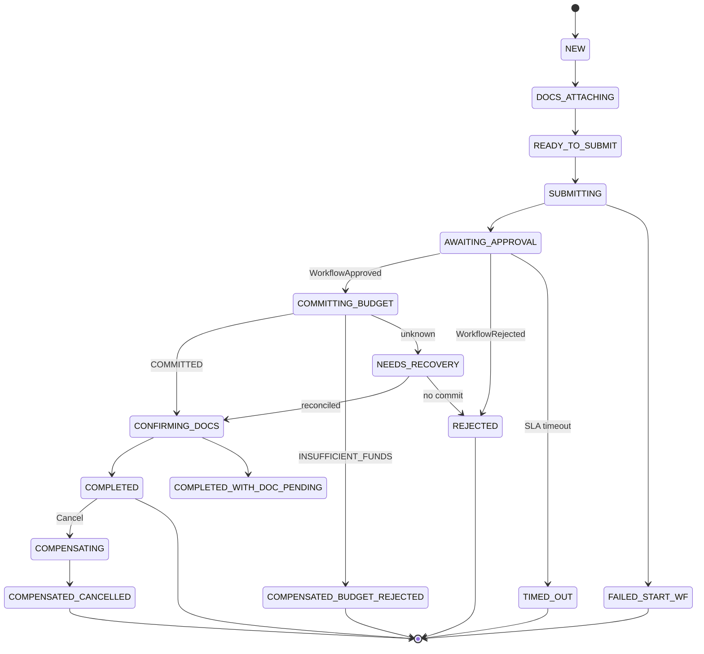

# 5. Tabla de estados de la saga
## SAGA-MVP-001

## 5.1 Estados de `PurchaseApprovalSaga`

| Estado saga | Significado | Estado típico PO/REQ | Fondos | WF |
|-------------|-------------|----------------------|--------|-----|
| `NEW` | Saga creada con borrador | DRAFT | — | — |
| `DOCS_ATTACHING` | Cargando/vinculando docs | DRAFT | — | — |
| `READY_TO_SUBMIT` | Guard documental OK | DRAFT | — | — |
| `SUBMITTING` | StartProcess en curso | DRAFT→SUBMITTED | — | starting |
| `AWAITING_APPROVAL` | Esperando tarea humana | SUBMITTED | — | RUNNING |
| `COMMITTING_BUDGET` | CommitBudget sync | SUBMITTED | committing | APPROVED outcome |
| `CONFIRMING_DOCS` | Post-commit doc confirm | APPROVED | COMMITTED | COMPLETED |
| `COMPLETED` | Éxito total | APPROVED | COMMITTED | COMPLETED |
| `COMPLETED_WITH_DOC_PENDING` | Aprobado; doc cierre pendiente | APPROVED | COMMITTED | COMPLETED |
| `REJECTED` | Rechazo humano | REJECTED | — | REJECTED |
| `COMPENSATED_BUDGET_REJECTED` | Fondos insuficientes post-approve | REJECTED | no commit | closed |
| `COMPENSATING` | Rollback en curso | * | * | * |
| `COMPENSATED_CANCELLED` | Cancelación post-commit | CANCELLED | RELEASED | cancelled |
| `TIMED_OUT` | Timeout aprobación | REJECTED/CANCELLED | — | cancelled |
| `FAILED_START_WF` | No arrancó WF | DRAFT | — | — |
| `NEEDS_RECOVERY` | Ambigüedad técnica | SUBMITTED | ? | ? |
| `FAILED` | Error no recuperable automático | * | * | * |

## 5.2 Transiciones permitidas

| Desde | Evento/comando | Hacia |
|-------|----------------|-------|
| NEW | docs start | DOCS_ATTACHING |
| DOCS_ATTACHING | checklist OK | READY_TO_SUBMIT |
| READY_TO_SUBMIT | Submit | SUBMITTING |
| SUBMITTING | WorkflowStarted | AWAITING_APPROVAL |
| SUBMITTING | start fail | FAILED_START_WF |
| AWAITING_APPROVAL | WorkflowApproved | COMMITTING_BUDGET |
| AWAITING_APPROVAL | WorkflowRejected | REJECTED |
| AWAITING_APPROVAL | timeout policy | TIMED_OUT |
| COMMITTING_BUDGET | COMMITTED | CONFIRMING_DOCS |
| COMMITTING_BUDGET | INSUFFICIENT_FUNDS | COMPENSATED_BUDGET_REJECTED |
| COMMITTING_BUDGET | timeout/unknown | NEEDS_RECOVERY |
| CONFIRMING_DOCS | docs OK | COMPLETED |
| CONFIRMING_DOCS | docs fail | COMPLETED_WITH_DOC_PENDING |
| COMPLETED | Cancel PO | COMPENSATING → COMPENSATED_CANCELLED |
| NEEDS_RECOVERY | reconcile COMMITTED | CONFIRMING_DOCS |
| NEEDS_RECOVERY | reconcile not committed | REJECTED / retry |

## 5.3 Diagrama de estados (Mermaid)

## 5.4 Dualidad estado saga vs estado de dominio

La UI muestra el **estado del agregado** (DRAFT/SUBMITTED/…).  
Ops/observabilidad monitorean el **estado de saga** (`NEEDS_RECOVERY`, `COMPLETED_WITH_DOC_PENDING`).
