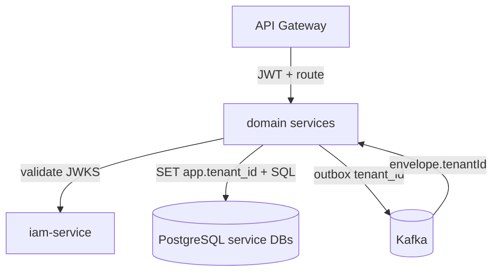

# 3. Diseño técnico
## CA-TEN-001

## 3.1 Capas

| Capa | Responsabilidad |
|------|-----------------|
| **Control Plane** | Registro de tenants, estado (ACTIVE/SUSPENDED), plane assignment (`SHARED` \| `DEDICATED`), módulos licenciados, DNS/gateway routes |
| **Data Plane Shared** | Cluster K8s + PostgreSQL (7 DBs servicio) + Kafka + Redis + object storage multi-tenant |
| **Data Plane Dedicated** | Stack equivalente aislado; preferible proyecto/cuenta cloud separada o VPC + instancias PG dedicadas |
| **Application** | Servicios Spring Boot tenant-aware; RLS session; outbox con `tenant_id` |

## 3.2 Modelo de datos de tenancy (control)

Entidades lógicas (pueden vivir en `iam-service` o futuro `tenant-service` post-MVP):

| Entidad | Campos clave |
|---------|--------------|
| `Tenant` | `id`, `code`, `name`, `status`, `plane_type`, `region`, `created_at` |
| `TenantModule` | `tenant_id`, `module_code`, `enabled` |
| `TenantPlaneBinding` | connection hints / cluster id (secrets fuera de DB app) |

MVP piloto: seed de **un** tenant ACTIVE en plane DEDICATED; registry mínimo en IAM o config.

## 3.3 PostgreSQL — patrón por servicio

```text
database: {service}_db          -- una por servicio por plane
schema:   public                -- único schema de app
tables:   * con tenant_id uuid NOT NULL
RLS:      ENABLE + FORCE ROW LEVEL SECURITY
policy:   tenant_id = current_setting('app.tenant_id')::uuid
```

### Roles

| Role | Privilegios |
|------|-------------|
| `{service}_migrator` | DDL, BYPASSRLS (solo CI/CD Flyway) |
| `{service}_app` | DML/SELECT, **NO** BYPASSRLS, NO DDL |
| `{service}_readonly` | SELECT (ops), preferible con RLS o filtro |

### Session bootstrap (cada request / TX)

```sql
SELECT set_config('app.tenant_id', :tenantId, true);  -- true = local to transaction
```

Implementación típica Spring: filtro/interceptor JDBC o `TenantAwareDataSource` que abre TX y setea config.

## 3.4 Object storage / Redis / Kafka

| Recurso | Estrategia |
|---------|------------|
| Object storage | Prefijo `{tenantId}/...` en keys; bucket por plane (dedicated bucket en piloto) |
| Redis | Key prefix `{tenantId}:`; DB index opcional por plane |
| Kafka | Topics compartidos en plane; **key** `tenantId:aggregateId`; consumers filtran/validan `tenantId` del envelope |
| Elasticsearch (futuro audit) | Index naming `{plane}-{tenant}` o campo `tenant_id` + filtro |

## 3.5 Gateway / Ingress

```text
Host dedicado piloto:  municipio-x.erp.example.gov
Host SaaS:             {tenantCode}.erp.example.com  OR  api.erp.example.com + JWT

Resolución orden (prod):
  1) JWT claim tenant_id (autoritativo tras auth)
  2) Opcional: host → tenantCode (pre-auth landing)
  3) Nunca confiar solo en X-Tenant-Id en prod
```

## 3.6 Dedicated Plane (piloto) — checklist

| Ítem | Valor |
|------|-------|
| Tenants en PG | Exactamente 1 ACTIVE (el piloto) |
| RLS | **ON** (enseña el músculo; protege bugs) |
| Kafka/Redis/Storage | Instancias/buckets no compartidos con SaaS |
| Network | Namespace K8s + NetworkPolicy |
| Backup | Instancia completa = restore de tenant |
| Mismo artefacto de imagen | Sí (no fork de código) |

## 3.7 Shared Plane (futuro SaaS) — checklist adicional

| Ítem | Valor |
|------|-------|
| Cuotas | rate-limit por tenant en gateway |
| Pooling | PgBouncer; límites por servicio |
| Observabilidad | métricas con label `tenant_id` (cuidado cardinalidad) |
| Export tenant | job lógico por `tenant_id` |
| Suspend | `Tenant.status=SUSPENDED` → gateway 403 |

## 3.8 Diagrama lógico


