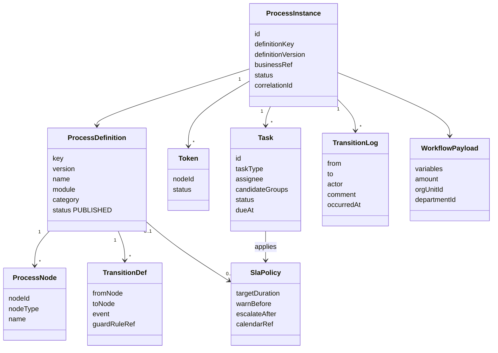
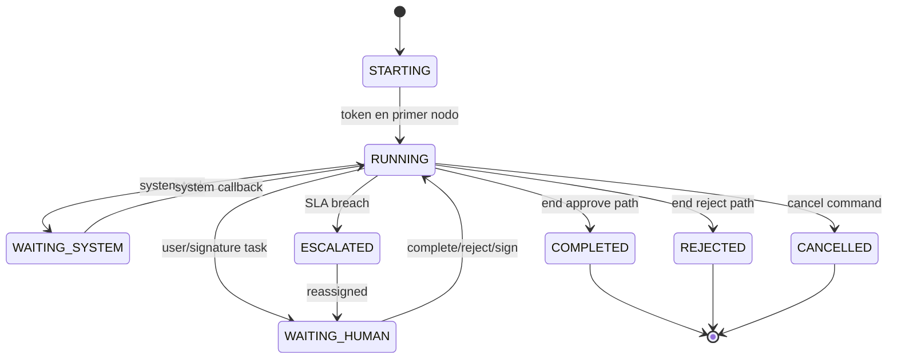

# 2. Modelo de Workflow
## BPM-001

## 2.1 Metamodelo

## 2.2 Conceptos

| Concepto | Definición |
|----------|------------|
| **ProcessDefinition** | Plantilla versionada del flujo (p.ej. `PO_APPROVAL:v3`) |
| **ProcessInstance** | Caso en ejecución ligado a un *businessRef* (`purchasing:PurchaseOrder:uuid`) |
| **Node** | Paso: START, USER_TASK, SYSTEM_TASK, SIGNATURE_TASK, REVIEW_TASK, GATEWAY, END |
| **Token** | Cursor de ejecución (soporta split/join simple en gateways) |
| **Task** | Unidad de trabajo humana o de sistema |
| **Transition** | Arco disparado por evento (`APPROVE`, `REJECT`, `EXPIRE`, `SIGN`, `SYSTEM_OK`) |
| **Variables** | Payload tipado mínimo para routing (monto, OU, depto, módulo, criticidad) |
| **BusinessRef** | Puntero al aggregate externo — sin poseer su estado de negocio |

## 2.3 Tipos de tarea

| taskType | Uso | Ejemplos |
|----------|-----|----------|
| `REQUEST` | Captura/solicitud inicial | Alta requisición ya creada dispara start; o tarea de completar datos |
| `REVIEW` | Revisión sin autoridad final | Revisión técnica / jurídica |
| `APPROVAL` | Aprobación con efecto | Jefe / Director / BUD_APPROVER |
| `REJECTION_HANDLING` | Corrección post-rechazo | Devolver a capturista |
| `SIGNATURE` | Firma electrónica / visto bueno formal | Firma de OC / dictamen |
| `SYSTEM` | Integración automática | `CommitBudget`, virus-scan doc, notify |
| `ACKNOWLEDGEMENT` | Enterado | Notificación con acuse |

## 2.4 Ciclo de vida de instancia (vista)

## 2.5 API conceptual del motor (contratos, no código)

| Command | Efecto |
|---------|--------|
| `DeployDefinition` | Publica versión |
| `StartProcess(defKey, businessRef, variables, starter)` | Crea instancia + primera task |
| `ClaimTask` / `AssignTask` | Asignación |
| `CompleteTask(outcome, comment, attachments)` | Dispara transición |
| `RejectTask(reason)` | Camino de rechazo |
| `SignTask(signatureRef)` | Completa SIGNATURE |
| `CancelProcess(reason)` | Fin anormal |
| `ReassignTask` / `EscalateTask` | Manual o por SLA |
| Query `Inbox(user)` / `ProcessStatus(businessRef)` | Read models |

## 2.6 Justificación del modelo

Separar **definition/instance/task** permite: (1) reutilizar el mismo motor en ERP y GRP, (2) versionar umbrales sin migrar casos abiertos, (3) auditar cada transición, (4) integrar firmas y sistemas como nodos de primera clase — patrón Camunda + Approvals Management.
