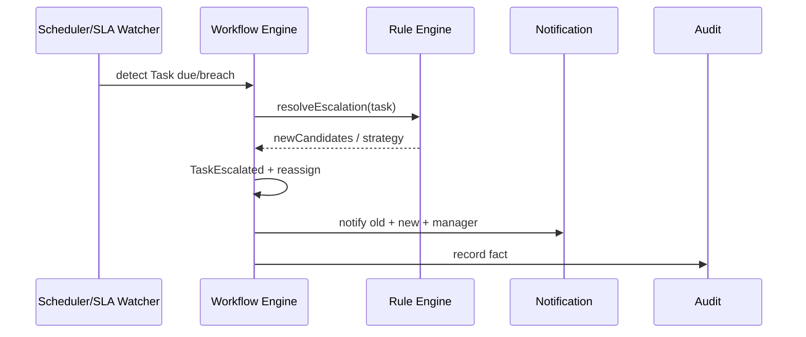

# 6. SLA, Recordatorios y Escalamiento automático
## BPM-001

## 6.1 Modelo SLA

```text
SlaPolicy:
  id
  appliesTo: TASK | PROCESS
  targetDuration      # p.ej. 16 business hours
  warnAtPercent       # p.ej. 50%, 80%
  breachAction        # REMIND | ESCALATE | REASSIGN | NOTIFY_CTRL
  escalateToStrategy  # MANAGER_OF_ASSIGNEE | ROLE_POOL | NAMED_POSITION
  maxEscalations
  businessCalendarRef # omite fines de semana/festivos municipales
```

## 6.2 Calendario laboral

| Elemento | Uso |
|----------|-----|
| Business hours | 09:00–17:00 America/Mexico_City (configurable) |
| Holidays | Catálogo por tenant |
| Pause conditions | Esperando SYSTEM externo (opcional pause clock) |

**Justificación:** SLA en horas corridas castiga injustamente al municipio; calendarios son estándar BPM enterprise.

## 6.3 Recordatorios (Reminders)

| Trigger | Acción |
|---------|--------|
| `warnAt 50%` | Notify assignee + inbox badge |
| `warnAt 80%` | Notify assignee + manager |
| `due - 2h` | Reminder final |
| Digest diario | Lista de tasks por vencer (opcional) |

Canal: Notification BC (in-app + email). Cada reminder genera `ReminderSent` auditado (anti-spam: max N/día/task).

## 6.4 Escalamiento automático



### Estrategias

| Strategy | Comportamiento |
|----------|----------------|
| `REMIND_ONLY` | Solo notifica (pre-breach) |
| `ESCALATE_TO_MANAGER` | Subir al jefe del assignee |
| `ESCALATE_TO_ROLE_POOL` | Poner en cola `DIRECTOR` / `BUD_APPROVER` |
| `REASSIGN_ROUND_ROBIN` | Redistribuir en pool |
| `DUPLICATE_WATCHER` | Mantiene assignee y agrega watcher (contraloría en U3+) |
| `AUTO_REJECT_ON_MAX` | Raro en público; configurable — default **off** para aprobaciones de gasto |

### Matriz sugerida piloto

| Proceso | Target SLA | Warn | Breach |
|---------|------------|------|--------|
| Requisición L1 | 8h hábiles | 50/80% | Escalate to Director |
| OC L2 | 16h hábiles | 50/80% | Escalate to Secretaría / pool |
| OC L3 Budget | 24h hábiles | 50/80% | Escalate + notify Contraloría si U3 |
| Firma OC | 8h hábiles | 80% | Escalate to alternate signer |
| Modificación presupuestal | 24–40h | 50/80% | Escalate to BUD_APPROVER backup |

## 6.5 Estado ESCALATED

- La task original pasa a `ESCALATED`/`CANCELLED` según política  
- Se crea nueva task a candidatos de escalamiento  
- `escalationLevel` incrementa hasta `maxEscalations`  
- UI marca “fuera de SLA” en inbox y en el business record

## 6.6 Métricas BPM

| KPI | Definición |
|-----|------------|
| % on-time tasks | Completadas antes de due |
| Mean time to approve | Por processKey y nivel |
| Escalation rate | Escaladas / creadas |
| Bottleneck OU | OU con mayor aging |
| Reject ratio | Rechazos / iniciadas |

## 6.7 Justificación

Sin SLA+escalamiento, el workflow se vuelve bandeja muerta. En GRP municipal es control operativo y de transparencia interna.
