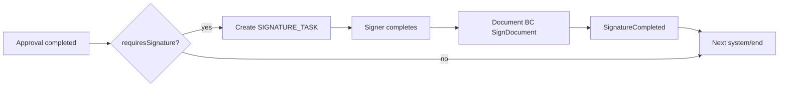

# 7. Firmas y Notificaciones
## BPM-001

## 7.1 Firmas en el workflow

La firma **no vive solo en UI**: es un `SIGNATURE_TASK` orquestado.

### Reglas
1. `signatureRef` debe apuntar a versión inmutable del documento.  
2. Firmante ∈ candidates (Position titular / delegado).  
3. Step-up MFA si política `requiresMfa`.  
4. Rechazo de firma = camino `SIGNATURE_REJECTED` (no se confunde con rechazo de aprobación previa).  
5. Multi-firma: patrón P5 paralelo o cadena (ordenada) según `signaturePolicy`.

### signaturePolicy (ejemplos)

| Policy | Firmantes |
|--------|-----------|
| `SINGLE_MANAGER` | Titular de la OU |
| `BUYER_AND_DIRECTOR` | Comprador + Director |
| `DUAL_HIGH_AMOUNT` | Director + BUD_APPROVER |

Integración: Document BC ejecuta la firma criptográfica/simple; Workflow solo orquesta y guarda evidencia del outcome.

## 7.2 Notificaciones

| Evento | Destinatarios | Canal |
|--------|---------------|-------|
| TaskCreated | Candidates / assignee | In-app + email |
| Reminder | Assignee (+ manager si warn alto) | In-app + email |
| TaskEscalated | Old, new, manager | Email + in-app |
| ProcessCompleted | Starter + watchers | In-app |
| ProcessRejected | Starter + last actor | In-app + email |
| SignatureRequested | Signer | In-app + email |
| SLA breached U3+ | Contraloría (watcher) | Email |

### Plantillas
`workflow.task.assigned`, `workflow.task.reminder`, `workflow.task.escalated`, `workflow.process.completed`, `workflow.signature.requested`

Variables: processName, businessRef, amount, dueAt, deepLink inbox.

## 7.3 Justificación

Tratar firma como nodo evita “aprobar sin firmar” en compras públicas. Notificaciones desacopladas (Notification BC) permiten multi-canal sin hinchar el engine.
