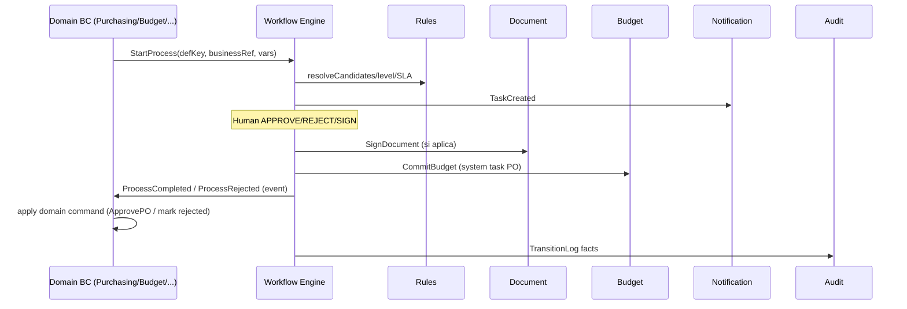

# 9. Integración con dominios
## BPM-001

## 9.1 Patrón de integración (reutilizable)

## 9.2 System tasks catalog (conectores)

| systemTask | BC destino | Uso |
|------------|------------|-----|
| `ValidatePayload` | Workflow | Preconditions |
| `CommitBudget` | Budget | PO approval path |
| `ReleaseBudgetHold` | Budget | Reject/cancel |
| `RequireDocuments` | Document | Gate evidencia |
| `SignDocument` | Document | Firma |
| `Notify` | Notification | Canales |
| `RecordAudit` | Audit | Redundante con aspect — explícito en nodos críticos |
| `PostJournal` | Accounting | F1+ |
| `SchedulePayment` | Treasury | F1+ |

## 9.3 Correlación

`businessRef = { boundedContext, aggregateType, aggregateId }`  
Unique active process per businessRef+processKey (salvo subprocess explícito).

## 9.4 Inbox unificado

Todos los módulos comparten:

- `/workflow/inbox` — tasks del usuario  
- Filtros: módulo, vencidas, escaladas, monto  
- Deep link al aggregate (OC, partida, pago…)

## 9.5 Reuso garantizado — contrato mínimo de módulo

Cualquier BC que quiera aprobaciones debe:

1. Exponer snapshot de variables al StartProcess  
2. Escuchar `ProcessCompleted/Rejected/Cancelled`  
3. No implementar su propio motor de estados de aprobación  
4. Respetar SoD vía atributos `createdBy`

## 9.6 Alineación MVP municipal

| Caso | processKey | Notas |
|------|------------|-------|
| Aprobar requisición | `PR_APPROVAL` | L1/L2 por monto y depto |
| Aprobar OC | `PO_APPROVAL` | + system `CommitBudget` + firma si U0+ |
| Modificar presupuesto | `BUDGET_MODIFICATION` | MFA en U2+ |
| Firmar dictamen/OC PDF | Signature node en PO / doc flow | Document BC |

## 9.7 Justificación final

Un solo Workflow Engine Enterprise evita la fragmentación típica (“cada módulo con su approval_status”) y centraliza SLA, escalamiento, firmas y auditoría de decisiones humanas — requisito de un ERP/GRP de clase enterprise.
