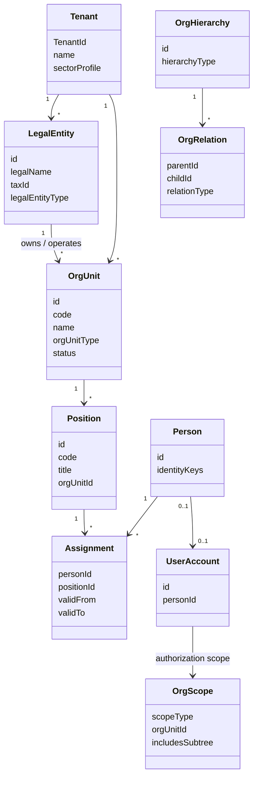

# 1. Metamodelo organizacional
## ORG-001

## 1.1 Principios (inspiración SAP / Oracle / Dynamics)

| Principio | Práctica de industria | Aplicación aquí |
|-----------|----------------------|-----------------|
| Separar **Entidad Legal** de **Unidad Organizacional** | SAP Company Code vs OM Org Unit; Oracle Legal Entity vs Department; Dynamics Legal Entity vs OU | `LegalEntity` ≠ `OrgUnit` |
| Una jerarquía operativa tipada | SAP Org Structure; Oracle Tree | `OrgUnit` + `OrgUnitType` + árbol |
| Puesto ≠ Persona ≠ Usuario | SAP Position/Person/User; HCM | `Position` → `Assignment` → `Person` → `UserAccount` |
| Permisos por rol **y** por alcance org | ABAC / security profiles | `Role` + `OrgScope` |
| Multi-tenant | SaaS ERP | Todo cuelga de `TenantId` |

**Justificación:** si se modela “Secretaría” como tabla distinta de “Dirección”, el producto no escala a empresas privadas ni a otros países/órdenes de gobierno. El metamodelo tipado es el patrón que permite un solo producto ERP+GRP.

---

## 1.2 Conceptos raíz

---

## 1.3 Definiciones

| Concepto | Definición reutilizable |
|----------|-------------------------|
| **Tenant** | Contenedor de aislamiento (municipio dedicado, empresa, holding group SaaS). |
| **LegalEntity (Empresa / Ente)** | Persona moral/jurídica con RFC/NIT y libros/obligaciones. |
| **OrgUnit** | Nodo de la estructura administrativa/operativa. |
| **OrgUnitType** | Clasificador: Holding, Empresa, Dependencia, Secretaría, Dirección… |
| **OrgHierarchy** | Árbol o grafo controlado (estructural, funcional, presupuestal, reporting). |
| **Position** | Plaza/puesto presupuestable o no, anclado a un OrgUnit. |
| **Person** | Persona física (empleado, funcionario, externo autorizado). |
| **Assignment** | Ocupación vigente de un Position por un Person. |
| **OrgScope** | Alcance de datos/autorización derivado de la OU (y opcionalmente subtree). |

---

## 1.4 Sector Profile (cómo se reutiliza)

| sectorProfile | Etiquetas preferidas | Reglas extra |
|---------------|----------------------|--------------|
| `PRIVATE_CORPORATE` | Holding, Empresa, Dirección, Gerencia, Departamento, Área | Multi-empresa (varios LegalEntity) frecuente |
| `PUBLIC_FEDERAL` | Dependencia, Secretaría, Subsecretaría, Dirección General… | Ente público + clave presupuestal |
| `PUBLIC_STATE` | Dependencia / Secretaría estatal | Similar federal |
| `PUBLIC_MUNICIPAL` | Presidencia, Secretarías, Direcciones, Coordinaciones… | Piloto actual |
| `MIXED` | Holding privado con fundación / organismo | Ambos tipados |

**Justificación:** el *sectorProfile* del tenant solo cambia **catálogo de tipos permitidos, labels i18n y validaciones**, no el esquema conceptual.
