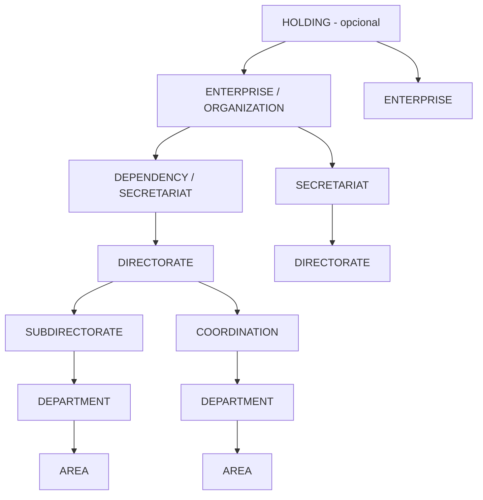

# 3. Jerarquías organizacionales
## ORG-001

## 3.1 Tipos de jerarquía (multi-árbol)

Una misma OrgUnit puede participar en **varias jerarquías** (patrón Oracle Trees / SAP evaluation paths):

| hierarchyType | Propósito | Uso ERP/GRP |
|---------------|-----------|-------------|
| `STRUCTURAL` | Organigrama oficial | Reportes, jefaturas, IAM scope default |
| `FUNCTIONAL` | Línea funcional matriz | Matriz / coordinación transversal |
| `BUDGET` | Unidad responsable del gasto | Disponibilidad y compromiso |
| `REPORTING` | Consolidación gerencial | Dashboards (no necesariamente legal) |
| `SECURITY` | Alcance de autorización especial | Delegaciones / encargos |

**Justificación:** en municipios la unidad que “aparece en el organigrama” no siempre es la misma que “tiene la partida”. Separar jerarquías evita forzar un solo árbol incorrecto.

---

## 3.2 Jerarquía estructural canónica

### Cardinalidad

| Relación | Cardinalidad | Regla |
|----------|--------------|-------|
| Padre estructural → hijos | 1:N | Un hijo tiene **un** padre estructural |
| Holding → empresas | 0..1 : N | Holding opcional |
| LegalEntity → OrgUnits | 1:N | Toda OU operativa referencia legal entity |
| OrgUnit → Positions | 1:N | |

---

## 3.3 Profundidad recomendada por perfil

| Perfil | Profundidad típica | Ejemplo |
|--------|--------------------|---------|
| PYME privada | 2–4 | Empresa → Dirección → Departamento → Área |
| Corporativo / Holding | 4–7 | Holding → Empresa → División → Dirección → Depto → Área |
| Municipio | 4–6 | Municipio → Secretaría → Dirección → Coordinación/Depto → Área |
| Estatal / Federal | 5–8 | Dependencia → Secretaría → Dir. Gral → Dir. Área → Depto → Área |

---

## 3.4 Reglas de jerarquía

1. **Acyclic:** el grafo estructural no admite ciclos.  
2. **Single structural parent:** un solo padre en `STRUCTURAL`.  
3. **Type compatibility:** matriz de “qué tipo puede colgar de qué tipo” configurable por `sectorProfile`.  
4. **Temporalidad:** movimientos de OU con vigencia; el histórico se conserva (no hard-delete).  
5. **Inactive cascade policy:** inactivar OU con hijos ACTIVE está bloqueado, o requiere reasignación.  
6. **LegalEntity consistency:** un hijo no puede pertenecer a otra LegalEntity distinta del padre salvo jerarquía `REPORTING` explícita intercompañía.

### Matriz de compatibilidad (default municipal)

| Padre ↓ / Hijo → | Secretaría | Dirección | Subdirección | Coordinación | Departamento | Área |
|------------------|------------|-----------|--------------|--------------|--------------|------|
| Organización/Municipio | ✓ | ✓* | — | — | — | — |
| Secretaría | — | ✓ | ✓ | ✓ | — | — |
| Dirección | — | — | ✓ | ✓ | ✓ | ✓ |
| Subdirección | — | — | — | ✓ | ✓ | ✓ |
| Coordinación | — | — | — | — | ✓ | ✓ |
| Departamento | — | — | — | — | — | ✓ |
| Área | — | — | — | — | — | — |

\*Algunos municipios ponen Direcciones adscritas directo a Presidencia/Organización.

### Matriz default privada

| Padre ↓ / Hijo → | Empresa | Dirección | Subdirección | Departamento | Área |
|------------------|---------|-----------|--------------|--------------|------|
| Holding | ✓ | — | — | — | — |
| Empresa | — | ✓ | — | ✓* | — |
| Dirección | — | — | ✓ | ✓ | ✓ |
| Departamento | — | — | — | — | ✓ |

---

## 3.5 Identificadores y path

Para performance de permisos y reportes:

| Campo derivado | Uso |
|----------------|-----|
| `path` / `materializedPath` | `/ORG/SEC-FIN/DIR-EGRESOS/AREA-PAGOS` |
| `level` | Profundidad |
| `rootOrgUnitId` | Raíz del tenant |

**Justificación:** habilita “incluye subtree” en ABAC sin recorrer el árbol en cada request (patrón común en ERP security).
