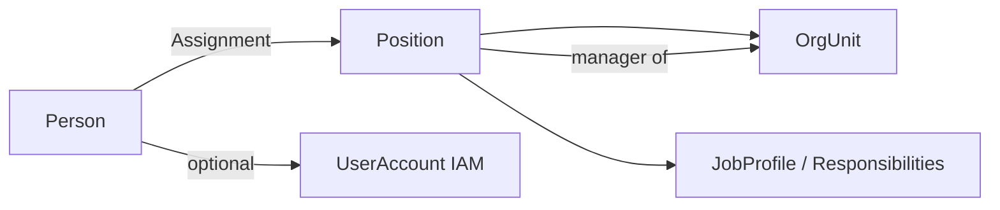

# 4. Responsabilidades y puestos
## ORG-001

## 4.1 Separación Persona / Puesto / Usuario

| Concepto | Responsabilidad |
|----------|-----------------|
| **Person** | Quién es (identidad humana) |
| **Position** | Qué plaza existe en la estructura (puede estar vacante) |
| **Assignment** | Quién ocupa la plaza y en qué vigencia |
| **UserAccount** | Credencial de acceso al sistema |
| **JobProfile** | Plantilla de responsabilidades/permisos sugeridos del puesto |

**Justificación:** en gobierno las plazas existen aunque estén vacantes; en corporativos hay interinatos y encargos. SAP OM y Oracle Position Management usan el mismo desacople.

---

## 4.2 Position (Plaza)

| Atributo | Descripción |
|----------|-------------|
| `code` | Clave de plaza |
| `title` | Titularidad (Director de…, Jefe de…) |
| `orgUnitId` | Unidad ancla |
| `positionType` | HEAD / STAFF / TEMPORARY / HONORARY |
| `isManager` | Si es jefatura de la OU |
| `grade` / `tabuladorRef` | Opcional (RRHH) |
| `budgetPositionRef` | Enlace a plaza presupuestal (público) |
| `maxIncumbents` | Normalmente 1; >1 para pools |

### Reglas
1. Una OU ACTIVE debería tener 0..1 `Position` manager vigente.  
2. No eliminar plazas con historial; se cierran por vigencia.  
3. Un `Assignment` overlapping en la misma plaza está prohibido si `maxIncumbents=1`.

---

## 4.3 Catálogo de responsabilidades (Job Responsibilities)

Reutilizable; se asocian a `JobProfile` y luego a `Position`:

| responsibilityCode | Descripción | Típico en |
|--------------------|-------------|-----------|
| `ORG_MANAGE_UNIT` | Administrar estructura hija | Jefaturas |
| `ORG_APPROVE_HR_MOVE` | Aprobar movimientos de personal | Dirección |
| `PROCURE_REQUEST` | Crear requisiciones | Área operativa |
| `PROCURE_APPROVE` | Aprobar compras de la OU/subtree | Jefe / Director |
| `BUDGET_RESPONSIBLE` | Ser unidad responsable de partidas | Dirección/Secretaría |
| `BUDGET_MODIFY` | Proponer modificaciones presupuestales | Analista + jefe |
| `BUDGET_APPROVE` | Aprobar modificaciones | Dirección financiera |
| `DOCUMENT_SIGN` | Firmar documentos del área | Titular |
| `AUDIT_READ_SCOPE` | Ver trails del alcance | Auditor |
| `TREASURY_PAYMENT_APPROVE` | Autorizar pagos del alcance | Tesorero / Director |
| `CATALOG_ADMIN` | Mantener catálogos | Admin |
| `IAM_ADMIN_LOCAL` | Alta de usuarios del alcance | Admin de dependencia |

**Justificación:** las responsabilidades son el puente entre organigrama y permisos funcionales (no confundir con `Role` técnico IAM, aunque se mapean).

---

## 4.4 Mapeo responsabilidad → rol IAM (sugerido)

| Responsabilidad | Roles IAM típicos |
|-----------------|-------------------|
| `PROCURE_REQUEST` | `CLERK`, `OPERATOR` |
| `PROCURE_APPROVE` | `AREA_MANAGER`, `DIRECTOR` |
| `BUDGET_RESPONSIBLE` | `BUD_ANALYST`, `DIRECTOR` |
| `BUDGET_APPROVE` | `BUD_APPROVER`, `DIRECTOR` |
| `AUDIT_READ_SCOPE` | `AUDITOR` |
| `IAM_ADMIN_LOCAL` | `ADMIN` (scoped) |
| `CATALOG_ADMIN` | `ADMIN` |

El **rol** concede el tipo de acción; el **OrgScope** limita sobre qué unidades aplica.

---

## 4.5 Encargos, interinatos y delegaciones

| Figura | Modelado |
|--------|----------|
| Titular | `Assignment` primary |
| Interino | `Assignment` con `assignmentType=INTERIM` |
| Encargo | `Assignment` + responsabilidades subset |
| Delegación temporal de aprobación | `Delegation` (fromPosition/toPerson, validFrom/to, responsibilityCodes) |

**Justificación GRP:** los encargos son cotidianos; deben dejar auditoría y no compartir usuario.
