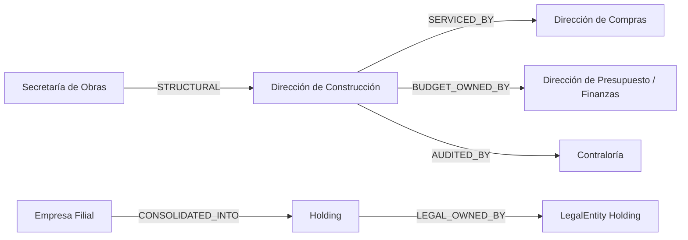

# 5. Dependencias entre unidades organizacionales
## ORG-001

Además de la jerarquía padre–hijo, el modelo contempla **dependencias explícitas** entre OU (relaciones no estructurales).

## 5.1 Tipos de dependencia (`OrgRelation.relationType`)

| relationType | Significado | Ejemplo |
|--------------|-------------|---------|
| `STRUCTURAL_PARENT` | Padre organigrama | Dirección ⊂ Secretaría |
| `REPORTS_TO_FUNCTIONAL` | Matriz funcional | Área de TI reporta funcional a Dir. Digital |
| `FUNDED_BY` | Quien financia / techo | Proyecto de Obras `FUNDED_BY` Tesorería/Presupuesto |
| `SERVICED_BY` | Unidad de soporte | Todas las secretarías `SERVICED_BY` Dirección de Compras |
| `AUDITED_BY` | Control interno | Unidades `AUDITED_BY` Contraloría |
| `CONSOLIDATED_INTO` | Reporting holding | Empresa A se consolida en Holding |
| `LEGAL_OWNED_BY` | Dueño legal | OU operativa owned by LegalEntity |
| `BUDGET_OWNED_BY` | Responsable presupuestal | Partidas de un área `BUDGET_OWNED_BY` Dirección X |
| `DELEGATES_TO` | Delegación estructural temporal | En ausencia, delega a otra OU/posición |

---

## 5.2 Dependencias críticas ERP+GRP

---

## 5.3 Reglas

1. `STRUCTURAL_PARENT` es único; otros relationTypes admiten N.  
2. `BUDGET_OWNED_BY` debe apuntar a OU ACTIVE con responsabilidad `BUDGET_RESPONSIBLE`.  
3. `SERVICED_BY` no otorga permisos automáticos; solo informa routing (p.ej. comprador central).  
4. `CONSOLIDATED_INTO` no implica acceso IAM automático entre empresas (requiere grant).  
5. Toda relación tiene vigencia y queda auditable.  
6. Prohibido dependencias cíclicas en `STRUCTURAL_PARENT` y en `CONSOLIDATED_INTO`.

---

## 5.4 Dependencias hacia otros dominios (no OU)

| Dominio | Dependencia organizacional |
|---------|----------------------------|
| Presupuesto | Partida → `responsibleOrgUnitId` |
| Compras | Requisición → `requestingOrgUnitId`; OC → `purchasingOrgUnitId` |
| Contabilidad | Centro de costo ↔ OrgUnit (1:1 o N:1) |
| RRHH/Nómina | Position/Assignment viven en OU |
| Workflow | Candidatos a aprobador = managers del path estructural o roles scoped |
| Auditoría | Scope de consulta por OU/subtree |
| Documentos | ACL por OU dueña del expediente |

**Justificación:** el organigrama es el **eje de ownership** de casi todas las transacciones municipales y corporativas.
