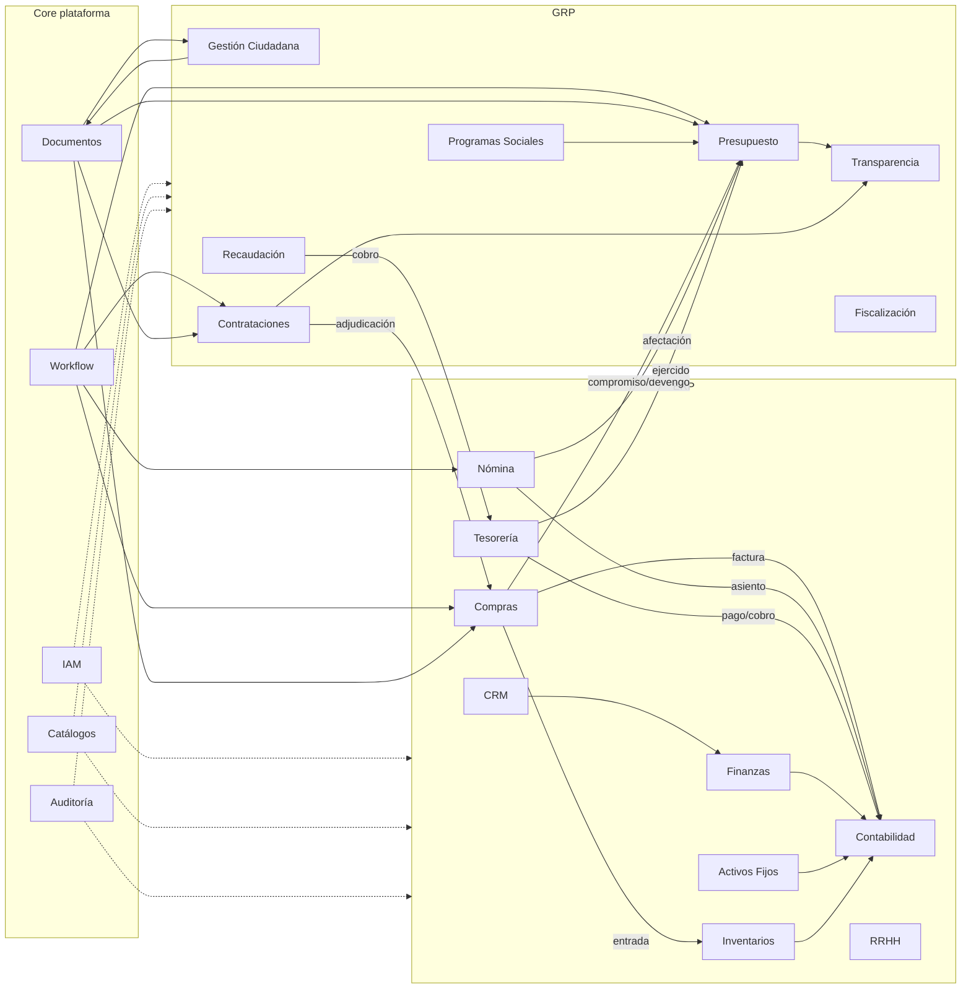
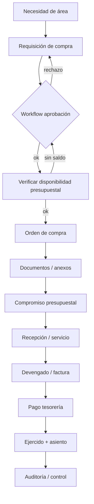

# Mapa General de Procesos
## BA-PROC-001 / Anexo A

## 1. Vista de value streams

## 2. Cadena de valor del piloto municipal (foco)

> En el **MVP** se cubre hasta compromiso + OC + documentos + auditoría.  
> En **Fase 1** se profundiza recepción → matching → pago → momentos presupuestales completos.

## 3. Mapa proceso de procesos por módulo

| Módulo | Procesos nivel 1 | Prioridad piloto |
|--------|------------------|------------------|
| Finanzas | Estructura financiera, periodos, FX, centros de costo | F2+ |
| Contabilidad | Plan de cuentas, asientos, cierre, estados | F1 parcial / F2 |
| Tesorería | Cuentas, pagos, cobros, conciliación | F1 parcial |
| Compras | Requisición, OC, recepción, factura | **MVP + F1** |
| Inventarios | Altas/bajas, traspasos, valuación | F2+ |
| RRHH | Altas, plazas, movimientos | F2+ / OUT nómina |
| Nómina | Incidencias, cálculo, pago, timbrado | **OUT-F1** |
| Activos Fijos | Alta, depreciación, baja | F2+ |
| CRM | Leads, oportunidades, cuentas | F2+ |
| Presupuesto Público | Formulación, aprobación, ejercicio, cuenta pública | **MVP + F1** |
| Transparencia | Obligaciones, publicación, atención | F2+ |
| Programas Sociales | Padrón, elegibilidad, dispersión | **OUT-F1** |
| Fiscalización | Auditorías, hallazgos, seguimiento | F2+ |
| Gestión Ciudadana | Trámites, citas, expediente | **OUT-F1** |
| Recaudación | Padrón, liquidación, cobro, rezago | **OUT-F1** |
| Contrataciones Públicas | Procedimiento, puja, adjudicación, contrato | F2+ |

## 4. Matriz de integración crítica ERP ↔ GRP

| Desde | Hacia | Evento / resultado de negocio |
|-------|-------|-------------------------------|
| Contrataciones | Compras | Contrato → OC / pedido |
| Compras | Presupuesto | Compromiso / ampliación |
| Compras | Inventarios | Entrada por recepción |
| Compras | Contabilidad | Provicion / factura |
| Nómina | Presupuesto + Contabilidad + Tesorería | Devengo y pago de nómina |
| Recaudación | Tesorería | Ingreso |
| Presupuesto | Transparencia | Publicación de ejercicio |
| Gestión Ciudadana | Documentos | Expediente |
| Cualquier mutación | Auditoría | Hecho auditable |

## 5. Actores transversales del mapa

Administrador · Auditor · Director · Jefe de Área · Capturista · Operador · Analista presupuestal · Comprador · Tesorero · Contador · Ciudadano *(fuera F1)* · Proveedor · Contribuyente *(fuera F1)*
