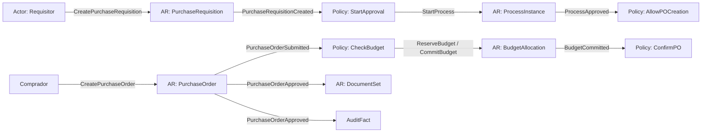

# 1. Event Storming
## DDD-001 / Event Storming Completo

## 1.1 Alcance del workshop (virtual)

| Capa | Inclusión |
|------|-----------|
| Hot path (detalle fino) | IAM, Catalog, Audit, Workflow, Document, Budget, Purchasing |
| Warm path (eventos + policies) | Accounting, Treasury, Public Procurement |
| Cold path (contexto + eventos futuros) | Inventory, HR, Payroll, Fixed Assets, CRM, Transparency, Social Programs, Oversight, Citizen, Tax |

**Justificación:** el piloto necesita precisión donde hay dinero público (compra↔presupuesto). El resto se modela lo suficiente para no romper el mapa, sin fingir el mismo nivel de detalle.

### Leyenda de sticky notes

| Color / tipo | Significado |
|--------------|------------|
| Command | Intención del actor (`CreateX`, `ApproveY`) |
| Domain Event | Hecho que ocurrió (`XCreated`, `YApproved`) |
| Aggregate | Consistencia transaccional |
| Policy | “Cuando ocurra E, entonces hacer C” (automatismo / reacción) |
| Actor | Persona o sistema que dispara commands |
| Read Model | Vista para decisión (p.ej. disponibilidad) |
| External System | Banco, IdP, etc. |

---

## 1.2 Big Picture — flujo pivote del piloto

**Justificación del pivote:** en municipios el dolor #1 es comprar sin control presupuestal. El storming se ancla ahí (como *commitment control* de Oracle / *funds management* SAP).

---

## 1.3 Event Storming por Bounded Context (Hot Path)

### BC Identity & Access (IAM) — MVP

| Actor | Command | Aggregate | Domain Event | Policy resultante |
|-------|---------|-----------|--------------|-------------------|
| Admin | `RegisterUser` | `UserAccount` | `UserRegistered` | Provisionar roles default del tenant |
| Admin | `AssignRole` | `UserAccount` | `RoleAssigned` | Refrescar menús/claims |
| Admin | `LockUser` | `UserAccount` | `UserLocked` | Revocar sesiones |
| Usuario | `Authenticate` | `Session` | `UserAuthenticated` | Emitir token / exigir MFA |
| Usuario | `VerifyMfa` | `Session` | `MfaSucceeded` / `MfaFailed` | Escalamiento / lockout |
| Admin | `DefineRole` | `Role` | `RoleDefined` | — |
| Sistema | `RevokeSession` | `Session` | `SessionRevoked` | Denylist Redis |

**Invariantes descubiertos**
- Username único por tenant.  
- No asignar rol inexistente en el tenant.  
- Lock impide nuevos `Authenticate` exitosos.

---

### BC Catalog — MVP

| Actor | Command | Aggregate | Event | Policy |
|-------|---------|-----------|-------|--------|
| Admin | `CreateCatalog` | `Catalog` | `CatalogCreated` | — |
| Admin | `AddCatalogItem` | `Catalog` | `CatalogItemAdded` | Invalidar cache |
| Admin | `UpdateCatalogItem` | `Catalog` | `CatalogItemUpdated` | Invalidar cache / notificar consumidores |
| Admin | `DeprecateCatalogItem` | `Catalog` | `CatalogItemDeprecated` | Bloquear nuevas referencias |

**Justificación:** catálogo como **OHS** (Open Host Service): muchos contextos lo leen; pocos escriben. Evita Shared Kernel anémico de “tablas lookup” globales sin dueño.

---

### BC Audit — MVP

| Actor | Command | Aggregate | Event | Policy |
|-------|---------|-----------|-------|--------|
| Policy/sistema | `RecordAuditFact` | `AuditTrail` | `AuditFactRecorded` | Indexar búsqueda |
| Auditor | `QueryTrail` | _(read model)_ | — | — |
| Sistema | `VerifyHashChain` | `AuditTrail` | `AuditIntegrityVerified` / `AuditIntegrityBroken` | Alerta seguridad |

**Justificación:** Audit no es “log técnico”. Es **contexto de compliance** con append-only y cadena de integridad (patrón cercano a *audit information systems* gubernamentales).

---

### BC Workflow — MVP

| Actor | Command | Aggregate | Event | Policy |
|-------|---------|-----------|-------|--------|
| Sistema/área | `StartProcess` | `ProcessInstance` | `ProcessStarted` | Crear primera `Task` |
| Aprobador | `CompleteTask` | `ProcessInstance` | `TaskCompleted` | Avanzar / bifurcar |
| Aprobador | `RejectTask` | `ProcessInstance` | `TaskRejected` | `ProcessRejected` |
| Sistema | `EscalateTask` | `ProcessInstance` | `TaskEscalated` | Reasignar / notificar |
| Sistema | `CancelProcess` | `ProcessInstance` | `ProcessCancelled` | Compensar origen |

**Policies clave**
- When `PurchaseRequisitionCreated` → `StartProcess(PURCHASE_REQ_APPROVAL)`.  
- When `PurchaseOrderSubmitted` → `StartProcess(PO_APPROVAL)` **o** aprobación embebida + check presupuestal.  
- When `ProcessApproved` & tipo PO → permitir `ApprovePurchaseOrder` / auto-approve según política.

**Justificación:** sacar el workflow del dominio de Compras evita reimplementar aprobaciones en Presupuesto/Contratos (lección SAP workflow / Dynamics approval engines).

---

### BC Document — MVP

| Actor | Command | Aggregate | Event | Policy |
|-------|---------|-----------|-------|--------|
| Usuario | `UploadDocument` | `Document` | `DocumentUploaded` | Virus scan async |
| Usuario | `LinkDocument` | `DocumentSet` / `Document` | `DocumentLinked` | — |
| Usuario | `SignDocument` | `Document` | `DocumentSigned` | — |
| Sistema | `VersionDocument` | `Document` | `DocumentVersioned` | Inmutabilidad versión N |

**Justificación:** en compras públicas municipales el documento **es evidencia**, no adjunto cosmético. Bounded Context propio evita que Purchasing posea storage/virus-scan/firma.

---

### BC Budget (Presupuesto Público) — MVP + F1

| Actor | Command | Aggregate | Event | Policy |
|-------|---------|-----------|-------|--------|
| Analista | `CreateBudgetCycle` | `BudgetCycle` | `BudgetCycleCreated` | — |
| Autoridad/Admin | `ApproveBudget` | `BudgetCycle` | `BudgetApproved` | Activar allocations |
| Analista | `ActivateAllocation` | `BudgetAllocation` | `BudgetAllocationActivated` | — |
| Sistema/Compras | `CommitBudget` | `BudgetAllocation` | `BudgetCommitted` | Confirmar OC / rechazar OC |
| Sistema | `AccrueBudget` | `BudgetAllocation` | `BudgetAccrued` | — |
| Sistema | `PayBudget` | `BudgetAllocation` | `BudgetPaid` | — |
| Analista | `ModifyBudget` | `BudgetAllocation` / `BudgetCycle` | `BudgetModified` | Recalcular disponibilidad |
| Sistema | `ReleaseCommitment` | `BudgetAllocation` | `BudgetCommitmentReleased` | Al cancelar OC |
| Analista | `FreezeAllocation` | `BudgetAllocation` | `BudgetAllocationFrozen` | Bloquear commits |

**Read model crítico:** `BudgetAvailabilityView` (clave → disponible).

**Policies**
- When `PurchaseOrderSubmitted` → `CommitBudget`.  
- When `CommitBudget` fails → `RejectPurchaseOrder` / devolver a borrador.  
- When `PurchaseOrderCancelled` → `ReleaseCommitment`.  
- When `GoodsReceived` / `InvoiceMatched` → `AccrueBudget` (F1).  
- When `PaymentExecuted` → `PayBudget` (F1).

**Justificación Aggregate `BudgetAllocation`:** la consistencia fuerte se necesita **por partida** (evitar sobregiro). El ciclo es agregado de gobernanza; la allocation es el aggregate de dinero. Separarlos evita contención global al aprobar el presupuesto anual.

---

### BC Purchasing (Compras) — MVP + F1

| Actor | Command | Aggregate | Event | Policy |
|-------|---------|-----------|-------|--------|
| Requisitor | `CreatePurchaseRequisition` | `PurchaseRequisition` | `PurchaseRequisitionCreated` | Start workflow |
| Sistema | `MarkRequisitionApproved` | `PurchaseRequisition` | `PurchaseRequisitionApproved` | Permitir OC |
| Comprador | `CreatePurchaseOrder` | `PurchaseOrder` | `PurchaseOrderCreated` | — |
| Comprador | `SubmitPurchaseOrder` | `PurchaseOrder` | `PurchaseOrderSubmitted` | Check budget + workflow |
| Sistema | `ApprovePurchaseOrder` | `PurchaseOrder` | `PurchaseOrderApproved` | Link docs; notify |
| Sistema | `RejectPurchaseOrder` | `PurchaseOrder` | `PurchaseOrderRejected` | — |
| Receptor | `RegisterGoodsReceipt` | `GoodsReceipt` / PO | `GoodsReceived` | Accrue + stock (F1/F2) |
| CxP | `MatchSupplierInvoice` | `SupplierInvoice` | `InvoiceMatched` / `InvoiceMatchFailed` | Accrue/AP (F1) |
| Comprador | `CancelPurchaseOrder` | `PurchaseOrder` | `PurchaseOrderCancelled` | Release budget |

**Justificación:** `PurchaseOrder` es Aggregate raíz del P2P (como en SAP EKKO/EKPO conceptual). La requisición es aggregate separado porque su ciclo de vida y aprobadores difieren.

---

## 1.4 Warm / Cold path — eventos esenciales

### Accounting
Commands: `CreateJournal`, `PostJournal`, `ReverseJournal`, `CloseFiscalPeriod`  
Events: `JournalEntryPosted`, `JournalEntryReversed`, `FiscalPeriodClosed`  
Policy: When `InvoiceMatched` / `PaymentExecuted` / `PayrollApproved` → `CreateJournal`

### Treasury
Commands: `SchedulePayment`, `ExecutePayment`, `RegisterCollection`, `ReconcileBank`  
Events: `PaymentExecuted`, `CollectionRegistered`, `BankReconciled`  
Policy: When `InvoiceMatched` → `SchedulePayment`; When `PaymentExecuted` → `PayBudget` + `PostJournal`

### Public Procurement
Commands: `PublishProcedure`, `SubmitBid`, `GrantAward`, `SignPublicContract`  
Events: `ProcedurePublished`, `AwardGranted`, `PublicContractSigned`  
Policy: When `PublicContractSigned` → `CreatePurchaseOrder` (ACL) + transparency publish

### Inventory
Events: `StockIncreased`, `StockDecreased` ← `GoodsReceived` / salidas

### HR / Payroll (OUT-F1)
Events: `EmployeeCreated`, `PayrollApproved`, `PayslipGenerated`  
Policy futura: `PayrollApproved` → Commit/Accrue/Pay budget + journals + payment

### Transparency / Citizen / Tax / Social / Oversight
Se modelan como contextos consumidores/productores futuros; ver Domain Model.

---

## 1.5 Policies globales (cross-context)

| ID | Policy | Trigger | Acción |
|----|--------|---------|--------|
| POL-AUD | Always audit mutations | Cualquier domain event de negocio | `RecordAuditFact` |
| POL-DOC | Evidence gate | `PurchaseOrderApproved` / `BudgetModified` | Exigir `DocumentLinked` según regla |
| POL-WF | Approval gate | Estados *Submitted* | `StartProcess` |
| POL-BUD-GUARD | Funds control | `PurchaseOrderSubmitted` | `CommitBudget` o rechazo |
| POL-NOTIFY | Notify actors | Task created / PO approved / Budget rejected | Enviar notificación *(canal; puede ser BC Notification)* |

**Justificación POL-BUD-GUARD:** es la *policy* más importante del piloto; equivale a *commitment control* obligatorio en GRP serio.

---

## 1.6 Puntos de controversia resueltos

| Pregunta | Decisión | Por qué |
|----------|----------|---------|
| ¿Budget check dentro de Purchasing? | **No** — command a Budget BC | Preserva lenguaje (partida ≠ línea OC) y evita invariantes ajenas en PO |
| ¿Workflow dentro de cada BC? | **No** — BC Workflow | Reuso y SoD centralizado |
| ¿Documentos como VO de PO? | **No** — BC Document | Ciclo de vida, virus scan, firma, retención legal |
| ¿Audit como Aspecto técnico? | **No** — BC Audit con contrato | Compliance y query forense |
| ¿Un solo Aggregate “Municipio”? | **No** | Big Ball of Mud; contención y despliegue imposibles |

---

## 1.7 Tablero consolidado de Domain Events (MVP)

| Evento | Productor | Consumidores |
|--------|-----------|--------------|
| `UserRegistered` | IAM | Audit, Notify |
| `RoleAssigned` | IAM | Audit |
| `CatalogItemUpdated` | Catalog | Purchasing, Budget (cache) |
| `ProcessStarted` / `TaskCompleted` / `ProcessApproved` | Workflow | Purchasing, Budget, Notify, Audit |
| `DocumentUploaded` / `DocumentLinked` | Document | Purchasing, Budget, Audit |
| `PurchaseRequisitionCreated` | Purchasing | Workflow, Audit |
| `PurchaseOrderSubmitted` | Purchasing | Budget, Workflow, Audit |
| `PurchaseOrderApproved` | Purchasing | Document policy, Audit, Notify, (Accounting F1) |
| `PurchaseOrderCancelled` | Purchasing | Budget, Audit |
| `BudgetCommitted` / `BudgetCommitmentReleased` | Budget | Purchasing, Audit, Notify |
| `BudgetApproved` | Budget | Transparency (futuro), Audit |
| `AuditFactRecorded` | Audit | Oversight (futuro) |
