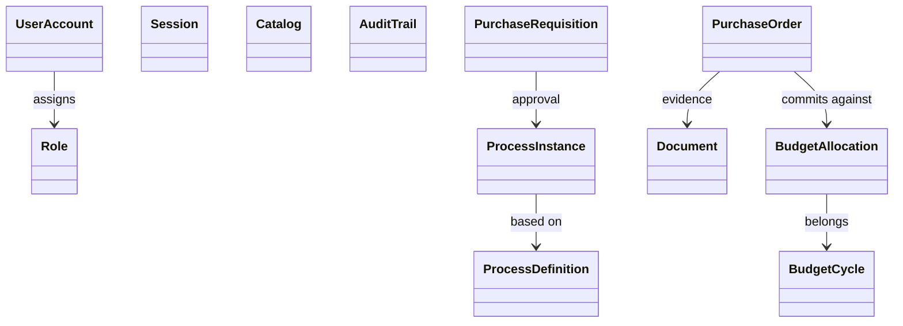

# 2. Domain Model
## DDD-001 / Aggregates · Entities · Value Objects

## 2.1 Convenciones del modelo

| Concepto | Criterio |
|----------|----------|
| **Aggregate Root** | Frontera de consistencia inmediata + invariantes |
| **Entity** | Identidad propia dentro del aggregate |
| **Value Object** | Igualdad por valor; inmutable |
| **Domain Event** | Hecho pasado del aggregate |
| **TenantId** | VO transversal en **todos** los aggregates de negocio |

**Justificación TenantId como VO (no Entity):** el tenant es identidad de partición, no un “cliente” del dominio de compras/presupuesto. Vive en IAM/Tenant BC; el resto solo porta el VO.

### VOs transversales (Shared Kernel *mínimo*)

> Shared Kernel deliberadamente pequeño. **Justificación:** evitar el anti-patrón “common.jar dios”.

| VO | Contenido | Usado por |
|----|-----------|-----------|
| `TenantId` | UUID | Todos |
| `Money` | amount + currency | Budget, Purchasing, Treasury, Accounting… |
| `PersonName` / `LocalizedText` | i18n | Catalog, IAM, Document metadata |
| `AuditMeta` | created/modified by/at + version | Persistencia; no necesariamente VO de dominio puro |
| `CorrelationId` | UUID | Policies/integración |

---

## 2.2 Core — Identity & Access

### Aggregate `UserAccount` (root)
| Tipo | Nombre | Responsabilidad |
|------|--------|-----------------|
| Entity | `UserAccount` | Identidad local del tenant |
| VO | `Email`, `Username` | Validación formato/unicidad |
| VO | `UserStatus` | ACTIVE/LOCKED/DISABLED |
| Entity/colección | `RoleAssignment` | Roles asignados (o VO set de RoleCode) |

**Invariantes:** username único; no autenticar si LOCKED; MFA flags coherentes.

### Aggregate `Role`
| Entity/VO | `Role`, `PermissionRef` |
| Invariantes | código único por tenant |

### Aggregate `Session`
| VO | `SessionId`, `Expiry`, `Amr` (pwd/otp) |
| Invariantes | sesión revocada no emite acceso |

**Justificación:** separar `Session` de `UserAccount` permite revocación masiva y MFA step-up sin cargar el aggregate de usuario.

---

## 2.3 Core — Catalog

### Aggregate `Catalog` (root)
| Tipo | Nombre |
|------|--------|
| Entity | `Catalog` (code, name) |
| Entity | `CatalogItem` (code, labels, attributes, status) |
| VO | `CatalogCode`, `ItemCode`, `LocalizedText`, `ItemStatus` |

**Invariantes:** item code único en catálogo; deprecated no se referencia en nuevas transacciones.

**Justificación Aggregate único Catalog:** la consistencia de códigos es por catálogo; versionar el catálogo completo evita items huérfanos inconsistentes.

---

## 2.4 Core — Audit

### Aggregate `AuditTrail` (root por entidad de negocio)
| Tipo | Nombre |
|------|--------|
| Entity | `AuditFact` (actor, action, before/after, occurredAt, hash, prevHash) |
| VO | `EntityRef` (type + id), `ActorRef`, `PayloadHash` |

**Invariantes:** solo append; hash encadena con previo; no update/delete de facts.

**Justificación:** modelar Trail como aggregate permite `VerifyHashChain` como comportamiento de dominio, no job técnico opaco.

---

## 2.5 Core — Workflow

### Aggregate `ProcessDefinition` (root)
| VO/Entity | key, version, steps/graph |

### Aggregate `ProcessInstance` (root)
| Entity | `Task` (assignee, status, dueDate) |
| VO | `ProcessKey`, `ProcessStatus`, `TaskStatus` |

**Invariantes:** no completar task de otra instancia; instancia COMPLETED/REJECTED inmutable; SLA/dueDate disparan escalamiento.

**Justificación dos aggregates:** definiciones versionadas no deben bloquearse con instancias en ejecución (patrón BPM engines).

---

## 2.6 Core — Document

### Aggregate `Document` (root)
| Entity | `DocumentVersion` |
| VO | `ContentRef` (storage URI), `MimeType`, `Checksum`, `RetentionPolicy` |

### Aggregate `DocumentSet` (opcional)
Colección de documentos ligados a un `EntityRef` (p.ej. PO).

**Invariantes:** versiones inmutables; link requiere document ACTIVE; firma solo sobre versión cerrada.

**Justificación DocumentSet:** evita que Purchasing conozca ids sueltos sin regla de expediente mínimo.

---

## 2.7 GRP — Budget

### Aggregate `BudgetCycle` (root)
| VO | `FiscalYear`, `CycleStatus` (DRAFT/APPROVED/ACTIVE/CLOSED) |
| Entities | referencias a allocations (ids) o creación orquestada |

### Aggregate `BudgetAllocation` (root) — **corazón del dinero público**
| Tipo | Nombre |
|------|--------|
| VO | `BudgetKey` / `ClavePresupuestal` |
| VO | `Money` authorized, committed, accrued, paid |
| Entity | `BudgetMovement` (type, amount, reference) opcionalmente dentro del AR |
| VO | `AllocationStatus` |

**Invariantes (regla de oro)**  
`authorized ≥ committed ≥ accrued ≥ paid`  
y `available = authorized - committed` para nuevos commits.

### VO `BudgetReference`
`referenceType` + `referenceId` (PO, CONTRACT, PAYROLL…)

**Justificación movements dentro del allocation:** el saldo es invariante local; los movements son el historial que sostiene el cálculo. Si el volumen explota, se puede pasar a Event Sourcing del allocation — decisión futura ADR.

---

## 2.8 ERP — Purchasing

### Aggregate `PurchaseRequisition` (root)
| Entity | `RequisitionLine` (item, qty, estimate) |
| VO | `RequisitionStatus`, `Money` |

### Aggregate `PurchaseOrder` (root)
| Entity | `PurchaseOrderLine` |
| VO | `PONumber`, `POStatus`, `SupplierId` (id ref), `Money` totals |
| VO | `BudgetKey` (ref a partida) por línea o cabecera |

### Aggregate `GoodsReceipt` (F1)
| Entity | lines recibidas | referencia `PurchaseOrderId` |

### Aggregate `SupplierInvoice` (F1)
| VO | matchStatus (MATCHED/PARTIAL/FAILED) |

**Invariantes PO**
- No aprobar sin líneas.  
- No aprobar sin `BudgetCommitted` confirmado (vía policy; el aggregate puede quedar en estado WAITING_FUNDS).  
- Cancelación solo si no hay recepción completa; libera commitment.

**Justificación SupplierId como referencia:** el maestro de proveedores puede vivir en BC Supplier/Catalog; Purchasing no posee el ciclo de vida del proveedor (anti Anti-Corruption al revés).

---

## 2.9 Warm path — Aggregates esenciales

### Accounting — `JournalEntry`
Entities: `JournalLine`  
VOs: `AccountId`, `Money`, `PostingStatus`  
Invariante: débitos = créditos al postear.

### Treasury — `PaymentOrder`, `BankAccount`
Invariante: no ejecutar pago CANCELLED; beneficiario requerido.

### Public Procurement — `ProcurementProcedure`, `Award`, `PublicContract`
Invariante: no firmar contrato sin Award; monto contrato ≥ compromisos derivados.

### Inventory — `StockItem` (warehouse+sku)
Invariante: no negativo.

### HR — `Employee`, `Position`
### Payroll — `PayrollRun`, `Payslip` (OUT-F1)
### Fixed Assets — `Asset`
### CRM — `Opportunity`, `CustomerAccount`
### Transparency — `PublicationObligation`
### Citizen — `Citizen`, `ServiceRequest`
### Tax — `Taxpayer`, `TaxAssessment`
### Social — `SocialProgram`, `BeneficiaryEnrollment`
### Oversight — `AuditCase`, `Finding`

---

## 2.10 Mapa Aggregate → Bounded Context (MVP)

---

## 2.11 Decisiones de modelado justificadas

| Decisión | Alternativa descartada | Motivo |
|----------|------------------------|--------|
| `BudgetAllocation` AR fuerte | Solo proyección SQL | Sobregiro es invariante de negocio, no de reporte |
| PO no contiene saldo presupuestal | Duplicar authorized/committed en PO | Doble fuente de verdad ERP/GRP |
| `Money` VO único | `BigDecimal` suelto | Multimoneda municipal eventual + claridad |
| Document BC separado | `byte[]` en PO | Retención legal, malware, firma |
| ProcessInstance ≠ PO | Campos approvedBy en PO | Reutilización y SoD |
| IDs cross-context | JOINs entre BCs | Independencia de despliegue y lenguaje |
