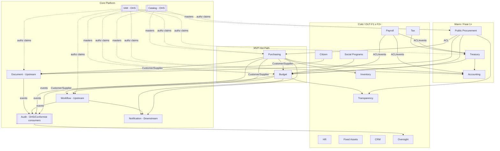

# 3. Context Map
## DDD-001 / Relaciones entre Bounded Contexts

## 3.1 Mapa (piloto municipal + landscape)

---

## 3.2 Catálogo de relaciones (patrones DDD)

| Upstream | Downstream | Patrón | Contrato | Justificación |
|----------|------------|--------|----------|---------------|
| IAM | Todos | **OHS** + Published Language (JWT claims) | OpenAPI/OIDC | Identidad única; no cada BC implementa login |
| Catalog | Purchasing, Budget, PRC… | **OHS** | APIs + events `CatalogItem*` | Maestros gobernados; evita duplicar códigos |
| Workflow | Purchasing, Budget, PRC, Payroll | **Customer/Supplier** | Commands `StartProcess` + events `Process*` | Motor transversal de aprobación |
| Document | Purchasing, Budget, PRC, Citizen | **Customer/Supplier** | `Upload/Link` + events | Evidencia legal reutilizable |
| Purchasing | Budget | **Customer/Supplier** | `CommitBudget` / events `BudgetCommitted` | Funds control; Budget es dueño del saldo |
| Budget | Purchasing | **Customer/Supplier** (respuesta) | success/fail commit | Purchasing reacciona (approve/reject PO) |
| Audit | — | **OHS** de escritura | `RecordAuditFact` | Todos conforman al contrato de Audit (**Conformist** en el envelope) |
| Public Procurement | Purchasing | **ACL** | Traduce Contract→PO | Lenguajes distintos (procedimiento ≠ OC) |
| Public Procurement | Budget | **Customer/Supplier** | Suficiencia / compromiso de contrato | No adjudicar sin fondos |
| Purchasing | Accounting | **Customer/Supplier** | events `InvoiceMatched` | Contabilidad no conoce UI de compras |
| Treasury | Budget | **Customer/Supplier** | `PayBudget` | Ejercido/pagado |
| Payroll | Budget/Accounting/Treasury | **ACL + events** | Nómina → momentos + asientos + pagos | OUT-F1; se deja el mapa listo |
| Budget / PRC | Transparency | **Conformist / CS** | projections a publicar | Transparencia no redefine presupuesto |
| Audit | Oversight | **OHS** | trails | Fiscalización consume hechos |
| Tax | Treasury | **CS** | cobros | OUT-F1 |
| Citizen | Document | **CS** | expediente | OUT-F1 |
| Social | Budget | **CS** | etiquetado | OUT-F1 |

---

## 3.3 Anti-Corruption Layers (ACL) definidas

### ACL-1 Procurement → Purchasing
| Concepto público | Concepto ERP |
|------------------|--------------|
| Procedimiento / Fallo / Contrato | Requisición formalizada / OC / Hitos de pago |
| Proveedor adjudicado | SupplierId |
| Monto máximo contractual | Techo de compromisos de OC hijas |

**Justificación:** si Purchasing “entiende” licitaciones, el lenguaje ubicuo se contamina (clásico fallo de ERPs genéricos en sector público).

### ACL-2 Payroll → Budget (futuro)
`PayrollRun` → movimientos por partida de servicios personales (no “líneas de OC”).

### ACL-3 Tax → Treasury (futuro)
`TaxPayment` → `Collection` con cuenta de ingreso, sin que Tesorería conozca padrones prediales.

---

## 3.4 Shared Kernel

| Qué se comparte | Qué NO se comparte |
|-----------------|--------------------|
| `TenantId`, `Money`, envelope de eventos, `EntityRef` | Tablas de PO, saldos presupuestales, usuarios, documentos binarios |

**Justificación:** Shared Kernel amplio es la puerta al monolito distribuido. Solo tipos semánticos estables.

---

## 3.5 Partnerships vs Upstream power

- **Partnership:** Purchasing ↔ Budget (MVP). Equipos deben co-diseñar contratos de commitment; ni uno puede “romper” al otro sin versionado.  
- **Upstream power:** IAM, Catalog, Workflow — cambian despacio, publican contratos.  
- **Downstream freedom:** Transparency, Oversight, Notification — se adaptan.

**Justificación Partnership Purchasing–Budget:** es el corazón del valor municipal; un Context Map “fire and forget” aquí produciría sobregiros o POs fantasma.
