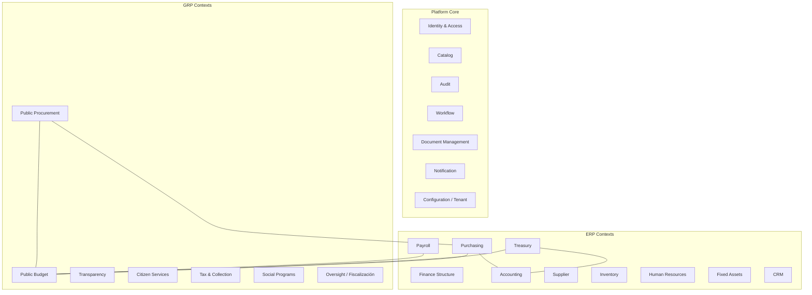

# 4. Bounded Contexts
## DDD-001 / Definición y diagrama

## 4.1 Diagrama de Bounded Contexts



---

## 4.2 Catálogo de Bounded Contexts

### Platform Core

| BC | Lenguaje ubicuo (ejemplos) | Responsabilidad | Prioridad |
|----|----------------------------|-----------------|-----------|
| Identity & Access | Usuario, Rol, Sesión, Permiso, MFA | Autenticación/autorización | **MVP** |
| Catalog | Catálogo, Ítem, Código, Vigencia | Maestros de referencia | **MVP** |
| Audit | Hecho, Trail, Hash, Actor | Evidencia inmutable | **MVP** |
| Workflow | Proceso, Tarea, Aprobación, Escalamiento | Orquestación humana | **MVP** |
| Document Management | Documento, Versión, Expediente, Checksum | Evidencia documental | **MVP** |
| Notification | Aviso, Canal, Plantilla | Comunicación | MVP-A opcional / soporte |
| Configuration / Tenant | Tenant, Módulo, Feature flag | Control plane | **MVP** (mínimo dedicado) |

### ERP

| BC | Lenguaje ubicuo | Responsabilidad | Prioridad |
|----|-----------------|-----------------|-----------|
| Finance Structure | Centro de costo, Periodo, FX | Estructura analítica | F2+ |
| Accounting | Cuenta, Asiento, Póliza, Balanza | Libro contable | F1 parcial |
| Treasury | Cuenta bancaria, Orden de pago, Conciliación | Liquidez | F1 parcial |
| Purchasing | Requisición, OC, Recepción, Match | P2P | **MVP+F1** |
| Supplier | Proveedor, Evaluación | Maestro proveedores | F1/F2 |
| Inventory | SKU, Existencia, Kardex | Stock | F2+ |
| Human Resources | Empleado, Plaza, Movimiento | Ciclo de personal | F2+ |
| Payroll | Corrida, Recibo, Incidencia | Cálculo y pago personal | **OUT-F1** |
| Fixed Assets | Activo, Depreciación, Baja | Patrimonio | F2+ |
| CRM | Lead, Oportunidad, Cuenta | Relación comercial | F2+ |

### GRP

| BC | Lenguaje ubicuo | Responsabilidad | Prioridad |
|----|-----------------|-----------------|-----------|
| Public Budget | Partida, Clave, Compromiso, Devengado, Ejercido | Funds control | **MVP+F1** |
| Public Procurement | Procedimiento, Propuesta, Fallo, Contrato | Contratación pública | F2+ |
| Transparency | Obligación, Publicación | Cumplimiento proactivo/reactivo | F2+ |
| Citizen Services | Trámite, Cita, Expediente ciudadano | Servicio al ciudadano | **OUT-F1** |
| Tax & Collection | Contribuyente, Liquidación, Rezago | Ingresos | **OUT-F1** |
| Social Programs | Beneficiario, Padrón, Dispersión | Programas sociales | **OUT-F1** |
| Oversight | Auditoría, Hallazgo, Remediación | Fiscalización | F2+ |

---

## 4.3 Justificación de fronteras (por qué estos BCs)

| Decisión de frontera | Por qué está bien trazada |
|----------------------|---------------------------|
| Purchasing ≠ Budget | Distinto lenguaje (OC vs Partida) y distinta invariante (líneas vs saldos) |
| Purchasing ≠ Public Procurement | Uno ejecuta; el otro adjudica bajo derecho público |
| Document ≠ Purchasing | Retención/firma/malware no son preocupaciones de P2P |
| Workflow ≠ cada BC de negocio | Evita N motores de aprobación divergentes |
| Audit ≠ logging técnico | Requiere modelo de integridad y consultas de compliance |
| Accounting ≠ Budget | Contabilidad patrimonial vs control de fondos públicos (SAP FI vs FM / Oracle GL vs Budget) |
| Treasury ≠ Accounting | Caja/bancos vs libro; se integran por eventos |
| Citizen ≠ IAM | Ciudadano externo ≠ usuario funcionario (modelos de identidad distintos) |

---

## 4.4 Contextos del MVP — vista C4 mental

```text
[Shell Municipal]
    → IAM (login)
    → Purchasing (requisición/OC)
    → Budget (disponibilidad/compromiso)
    → Workflow (inbox aprobaciones)
    → Document (anexos)
    → Audit (consulta trail)
    → Catalog (combos maestros)
```

**Justificación de cohesión MVP:** un funcionario municipal completa un caso real de gasto controlado sin salir del lenguaje del ayuntamiento (requisición, partida, oficio/PDF, firma de jefe).
