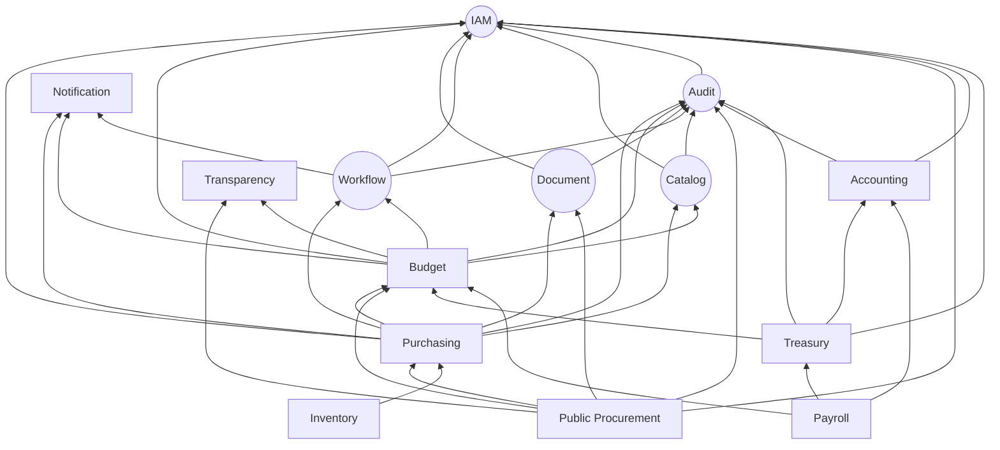

# 5. Dependencias entre dominios
## DDD-001 / Dirección, criticidad y justificación

## 5.1 Principio rector

> **Las dependencias de runtime fluyen por commands síncronos solo cuando hay invariante de decisión inmediata; el resto es evento asíncrono.**  
> **Ningún BC de core depende de ERP/GRP.**

**Justificación:** equivale a la disciplina de plataformas Dynamics (Dataverse apps) / SAP BTP events: el core no “conoce” compras.

---

## 5.2 Grafo de dependencias (runtime)



---

## 5.3 Matriz de dependencias (MVP)

| BC origen | Depende de | Tipo | Criticidad | Justificación |
|-----------|------------|------|------------|---------------|
| Purchasing | IAM | sync authz | Crítica | Sin identidad no hay SoD |
| Purchasing | Catalog | sync/read | Alta | Ítems, UAs, unidades de medida |
| Purchasing | Workflow | sync+async | Crítica | Aprobaciones |
| Purchasing | Budget | sync command | **Crítica** | No aprobar OC sin fondos |
| Purchasing | Document | sync+async | Alta | Evidencia de OC |
| Purchasing | Audit | async | Crítica | Compliance |
| Budget | IAM | sync | Crítica | Autorización de modificaciones |
| Budget | Catalog | read | Alta | Claves / clasificadores |
| Budget | Workflow | sync+async | Alta | Aprobación de modificaciones / ciclo |
| Budget | Audit | async | Crítica | Trazabilidad de saldos |
| Workflow | IAM | sync | Crítica | Asignación de tareas |
| Document | IAM | sync | Alta | ACL por documento |
| Catalog | IAM | sync | Media | Solo admin escribe |
| Audit | IAM | sync | Media | Quién consulta trails |
| Notification | events | async | Media | No bloquea invariantes |

---

## 5.4 Dependencias prohibidas (anti-grafos)

| Dependencia prohibida | Por qué se prohíbe |
|-----------------------|--------------------|
| IAM → Purchasing/Budget | Core no puede acoplarse a un dominio de negocio |
| Audit → Purchasing (sync fuerte) | Audit debe poder registrar cualquier BC vía contrato genérico |
| Budget → Accounting (obligatoria en MVP) | El control de fondos existe aunque el libro contable aún no esté maduro |
| Purchasing → Public Procurement | La ejecución no debe requerir al módulo de licitaciones |
| Catalog → Budget/Purchasing | Los maestros no dependen de transaccionales |
| Document → Budget saldos | El archivo no calcula dinero |

**Justificación:** estas prohibiciones preservan el orden de composición del MVP y el futuro multi-módulo on/off.

---

## 5.5 Dependencias de datos vs de control

| Tipo | Ejemplo | Implementación conceptual |
|------|---------|---------------------------|
| **Control síncrono** | `CommitBudget` al submit de OC | API + transacción local en Budget + respuesta |
| **Hecho asíncrono** | `PurchaseOrderApproved` → notify/audit | Event bus |
| **Referencia por ID** | `supplierId`, `budgetKey`, `documentId` | Sin FK cross-DB |
| **ACL traducción** | Contrato → OC | Anti-Corruption Layer |

**Justificación Commit síncrono:** el usuario necesita saber *en el acto* si hay dinero. Un eventual `BudgetCommitted` minutos después genera POs inválidas (inaceptable en GRP).

---

## 5.6 Orden de implementación DDD (derivado de dependencias)

```text
1. IAM + Tenant/Config
2. Audit + Catalog
3. Workflow + Document
4. Budget (allocations + commit/release)
5. Purchasing (PR/PO + integración policies)
6. (F1) GoodsReceipt + InvoiceMatch + Treasury/Accounting mínimos
7. (F2+) Procurement, Transparency, Inventory...
8. (OUT-F1 congelado) Payroll, Citizen, Tax, Social, BI/IA
```

**Justificación del orden:** respeta el grafo; no se puede testear funds control sin Budget; no se puede testear PO realista sin Workflow/Document/Audit en un municipio auditado.

---

## 5.7 Riesgos de dependencia y mitigación

| Riesgo | Mitigación DDD |
|--------|----------------|
| Chatty sync Purchasing↔Budget | API de availability + commit idempotente; timeout + rechazo controlado |
| Cascada de eventos rotos | Policies versionadas; outbox; contratos Published Language |
| Acoplamiento por “DTO compartido gigante” | Eventos mínimos por BC; ACL donde cambie el lenguaje |
| Equipos avanzando en frío (Citizen) rompen core | Freeze OUT-F1; Context Map governance |

---

## 5.8 Síntesis ejecutiva

1. **Partnership crítico:** Purchasing ↔ Budget.  
2. **OHS de plataforma:** IAM, Catalog, Audit.  
3. **Upstream de coordinación:** Workflow, Document.  
4. **ACL obligatoria futura:** Public Procurement → Purchasing.  
5. **Independencia del core:** cero dependencias hacia ERP/GRP.
