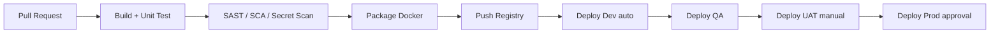

# Pipeline CI/CD

Stages GitHub Actions:
1. detect-changes (path filters)
2. backend-maven (test, spotbugs, jacoco)
3. frontend-npm (lint, test, build)
4. docker-build-push
5. helm-lint / kubeconform
6. deploy-env
