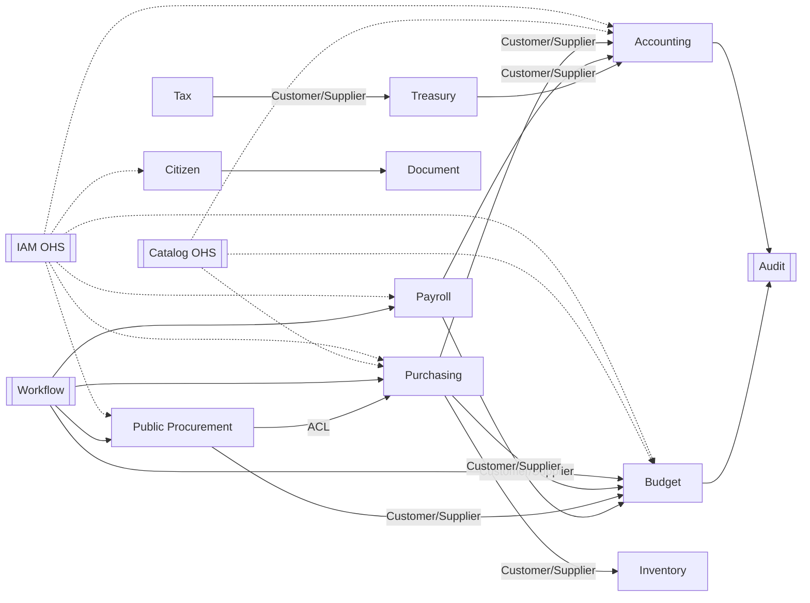

# Context Map ERP+GRP

## Dependencias críticas (acyclic rule)

Los contextos de **Core** no dependen de ERP/GRP.  
ERP no depende de GRP excepto vía **ACL** en adaptadores de integración.  
GRP puede consumir eventos ERP (Conformist) pero traduce con ACL.
