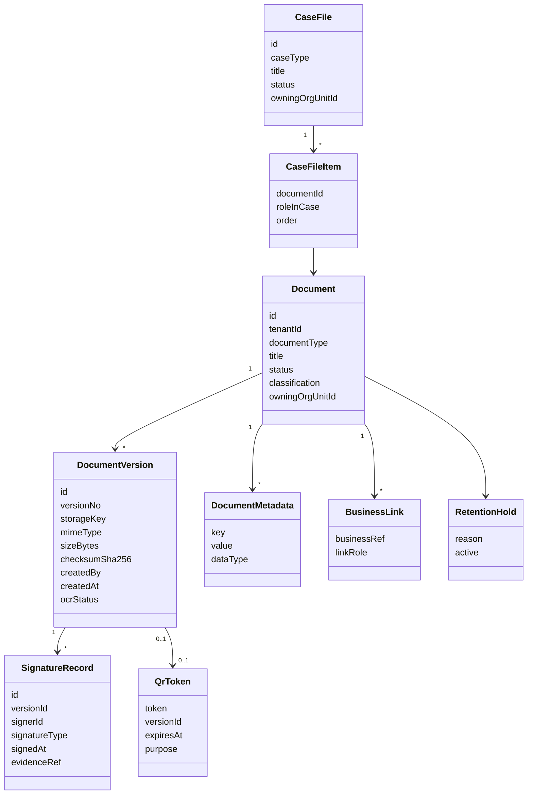

# 2. Modelo documental
## EDM-001

## 2.1 Metamodelo

## 2.2 Aggregates (alineado DDD)

| Aggregate | Contenido | Invariantes |
|-----------|-----------|-------------|
| **Document** | Metadatos, versiones, links, clasificación | Versiones append-only; status coherente |
| **CaseFile (Expediente)** | Colección ordenada de documentos + links de negocio | No borrar ítems con hold; cierre controlado |
| **SignatureRecord** | (dentro de Document o hijo de Version) | Solo sobre versión inmutable |

## 2.3 Estados de Document

| Estado | Significado |
|--------|-------------|
| `DRAFT` | En carga/edición de metadatos |
| `ACTIVE` | Vigente para uso |
| `UNDER_REVIEW` | En flujo documental/BPM |
| `SIGNED` | Tiene al menos firma requerida cumplida |
| `SUPERSEDED` | Reemplazado por otra versión/documento |
| `ARCHIVED` | En archivo / retención |
| `DISPOSED` | Dispuesto conforme a política (metadatos quedan) |

## 2.4 Tipos documentales (DocumentType) — catálogo

### Transversales
`GENERIC_ATTACHMENT`, `IDENTITY_ID`, `LEGAL_OPINION`, `PHOTO_EVIDENCE`, `SPREADSHEET`, `OTHER`

### ERP
`PURCHASE_REQUISITION_SUPPORT`, `QUOTE`, `PURCHASE_ORDER`, `GOODS_RECEIPT_NOTE`, `SUPPLIER_INVOICE`, `PAYMENT_VOUCHER`, `CONTRACT_COMMERCIAL`, `EMPLOYEE_FILE_DOC`, `ASSET_ACT`

### GRP / Gobierno
`OFFICIAL_LETTER`, `BUDGET_MODIFICATION_ACT`, `PROCUREMENT_BASES`, `BID_PROPOSAL`, `AWARD_ACT`, `PUBLIC_CONTRACT`, `CITIZEN_REQUEST_DOC`, `TAX_ASSESSMENT_NOTICE`, `TRANSPARENCY_PACKAGE`, `AUDIT_EVIDENCE`

## 2.5 Clasificación de sensibilidad

| classification | Tratamiento |
|----------------|-------------|
| `PUBLIC` | Publicable / QR público posible |
| `INTERNAL` | Solo tenant autenticado + scope |
| `CONFIDENTIAL` | Scope estricto + no export masivo |
| `RESTRICTED_PII` | PII — MFA para export; retención especial |

## 2.6 BusinessLink

`businessRef = { boundedContext, aggregateType, aggregateId }`  
`linkRole = SUPPORTING | PRIMARY | SIGNED_COPY | EVIDENCE | ANNEX`

**Justificación:** igual que ArchiveLink SAP: el documento se *apunta* desde el negocio sin incrustar blobs en el aggregate de compras.
