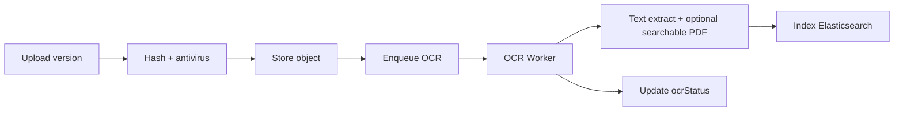

# 4. Versiones, Hash, QR y OCR
## EDM-001

## 4.1 Versionado

| Regla | Detalle |
|-------|---------|
| Numeración | Entero monotónico `1..N` por Document |
| Inmutabilidad | Version N no se sobrescribe |
| Current pointer | `Document.currentVersionId` |
| Major reason | `UPLOAD`, `OCR_DERIVATIVE`, `SIGNED_RENDER`, `REDACTION` |
| Prev link | `previousVersionId` |

Flujos que crean versión:
1. Nueva carga del usuario  
2. Render firmado (PDF con estampa)  
3. Derivado OCR (texto/PDF searchable) — opcional como versión `DERIVED` o asset paralelo

## 4.2 Hash documental

| Propiedad | Decisión |
|-----------|----------|
| Algoritmo | **SHA-256** (contenido binario almacenado) |
| Momento | Al completar upload (server-side) |
| Persistencia | En `DocumentVersion.checksumSha256` |
| Verificación | Job periódico + API `verifyIntegrity` |
| Cadena | Opcional: hash encadena con version previa (`prevContentHash`) para paquete de evidencia |
| Audit | Todo mismatch → `DocumentIntegrityBroken` + alerta Security |

**Justificación:** SHA-256 es estándar de integridad en ECM/archiving; suficiente para evidencia administrativa (firma avanzada aporta no-repudio adicional).

### Hash de expediente (opcional F1+)
`caseFileManifestHash = H(sorted(docId+versionNo+checksum))` al cerrar expediente.

## 4.3 Códigos QR

| Uso | Descripción |
|-----|-------------|
| Verificación de autenticidad | QR en PDF firmado apunta a portal/API de verificación |
| Localización rápida | QR con `documentId`/`versionNo` para captura móvil interna |
| Expediente | QR de carátula del case file |

### QrToken
- `token` opaco firmado (JWT corto o random + tabla)  
- `purpose`: `VERIFY_PUBLIC` | `VERIFY_INTERNAL` | `CHECKIN`  
- Expira o es revocable  
- La página de verificación muestra: título, tipo, hash corto, firmantes, estado, tenant (sin PII sensible en público)

**Perfil gobierno:** verificación pública de actos firmados (contratos/acuerdos) cuando `classification=PUBLIC`.  
**Perfil empresa:** verificación interna/partners autenticados por defecto.

## 4.4 OCR

| Campo | Valores |
|-------|---------|
| `ocrStatus` | `NOT_REQUIRED`, `PENDING`, `RUNNING`, `SUCCEEDED`, `FAILED`, `SKIPPED` |
| Idiomas | `es`, `en` (+ tenant config) |
| Formatos | PDF, PNG, JPEG, TIFF |
| Fallo | No bloquea ACTIVE; bloquea solo si policy `OCR_MANDATORY` |

**MVP:** OCR async opcional para PDFs escaneados de anexos.  
**F2+:** búsqueda full-text en expedientes y transparencia.

## 4.5 Antivirus / contenido

Gate obligatorio pre-ACTIVE: scan asíncrono/síncrono corto; cuarentena si malware. Evento `DocumentQuarantined`.
