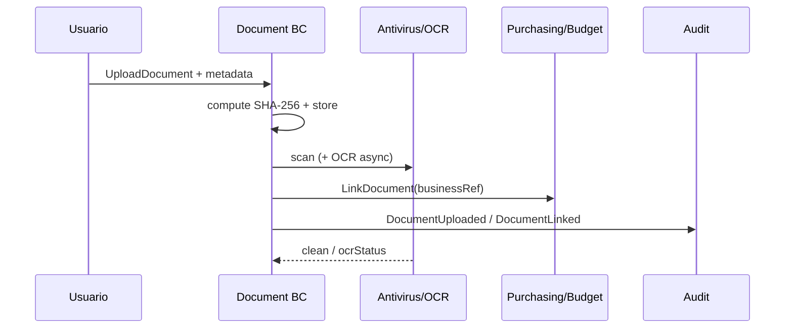
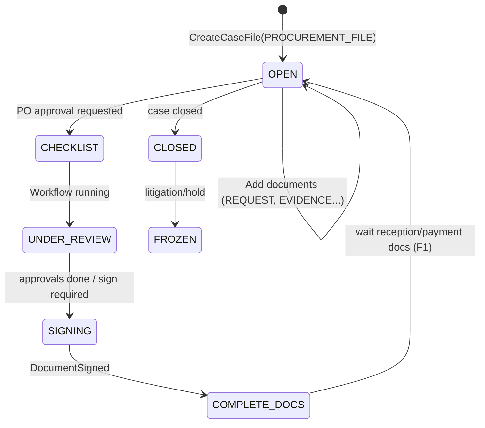

# 6. Flujos documentales
## EDM-001

## 6.1 Flujo A — Carga y vinculación (MVP)

## 6.2 Flujo B — Expediente de compra

## 6.3 Flujo C — Revisión / aprobación documental (BPM)

Plantilla `GENERIC_REVIEW_APPROVE_SIGN` aplicada a documentos sensibles (`LEGAL_OPINION`, `AWARD_ACT`).

Estados documento: `DRAFT → UNDER_REVIEW → ACTIVE/SIGNED` o rechazo a `DRAFT` con comentarios.

## 6.4 Flujo D — Verificación QR

1. Escaneo QR → token.  
2. API/portal valida token.  
3. Muestra metadatos no sensibles + hash + firmantes + estado.  
4. Si `INTERNAL`, exige login.  
5. Audit `DocumentVerified` (rate-limited).

## 6.5 Flujo E — Retención / disposición

`ACTIVE → ARCHIVED → (review) → DISPOSED` o `RetentionHold` congela disposición.

## 6.6 Eventos de dominio EDM

| Evento | Productores/Consumidores |
|--------|--------------------------|
| `DocumentUploaded` | Audit, OCR, Antivirus |
| `DocumentVersioned` | Audit |
| `DocumentLinked` | Purchasing, Budget, BPM checklist |
| `DocumentSigned` | BPM, Audit, Notification |
| `DocumentQuarantined` | Security, Notify admin |
| `CaseFileOpened` / `CaseFileClosed` | Audit, Transparency(F2) |
| `DocumentIntegrityBroken` | Security alert |
| `DocumentDisposed` | Audit |
