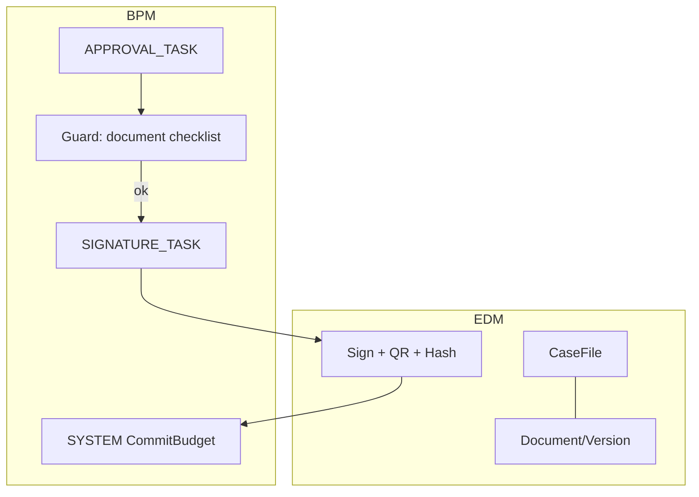

# 9. Integración con Workflow y Auditoría
## EDM-001

## 9.1 Integración con Workflow (BPM-001)

| Punto de enganche | Comportamiento |
|-------------------|----------------|
| StartProcess | Variables pueden incluir `caseFileId` / required docs |
| Guard `REQUIRE_DOCUMENT_SET` | Consulta EDM checklist del expediente |
| System task `RequireDocuments` | Bloquea avance si faltan rolesInCase |
| `SIGNATURE_TASK` | Invoca EDM SignDocument |
| ProcessCompleted | Puede cerrar sección del expediente o adjuntar acta |
| ProcessRejected | Mantiene docs; marca review comments metadata |

### Contratos de integración (eventos/commands)

| Dirección | Mensaje |
|-----------|---------|
| BPM → EDM | `SignDocument`, `ValidateCaseChecklist` |
| EDM → BPM | `DocumentSigned`, `ChecklistFailed`, `ChecklistPassed` |
| Domain → EDM | `LinkDocument`, `OpenCaseFile` |
| EDM → Domain | `DocumentLinked` (read sides) |

## 9.2 Integración con Auditoría (Audit BC)

### Hechos auditables mínimos

| Acción EDM | Audit action |
|------------|--------------|
| Upload | `DOCUMENT_UPLOADED` |
| Nueva versión | `DOCUMENT_VERSIONED` |
| Link/unlink | `DOCUMENT_LINKED` / `UNLINKED` |
| Cambio metadatos | `DOCUMENT_METADATA_UPDATED` |
| Download/export | `DOCUMENT_DOWNLOADED` (especialmente CONFIDENTIAL) |
| Firma | `DOCUMENT_SIGNED` |
| Verify QR | `DOCUMENT_VERIFIED` |
| Quarantine | `DOCUMENT_QUARANTINED` |
| Integrity fail | `DOCUMENT_INTEGRITY_BROKEN` |
| Archive/Dispose | `DOCUMENT_ARCHIVED` / `DISPOSED` |
| Hold | `RETENTION_HOLD_APPLIED` |

### Payload de AuditFact (contenido)

`actor`, `tenantId`, `documentId`, `versionNo`, `checksum`, `businessRef`, `orgUnitId`, `result`, `ip/traceId`

**Justificación:** en gobierno, “quién descargó el expediente” es tan crítico como “quién aprobó la OC”.

## 9.3 Correlación end-to-end

`correlationId` / `causationId` fluyen: Purchasing command → BPM → EDM sign → Audit facts con el mismo correlationId.

## 9.4 ACL documental vs OrgScope

Además del OrgScope del usuario:

- ACL explícita por documento (usuarios/grupos extra)  
- Herencia default desde `owningOrgUnitId` subtree  
- Excepción: Contraloría / Auditor read en series auditables  

## 9.5 Secuencia piloto (OC firmada)

1. Comprador vincula anexos al CaseFile de la OC.  
2. Workflow de aprobación valida checklist.  
3. Director aprueba (BPM).  
4. EDM firma (stamp+MFA) → nueva versión + QR + hash.  
5. Audit registra upload, link, approve (BPM), sign, download posteriores.  
6. Budget commit system task sigue en BPM.
