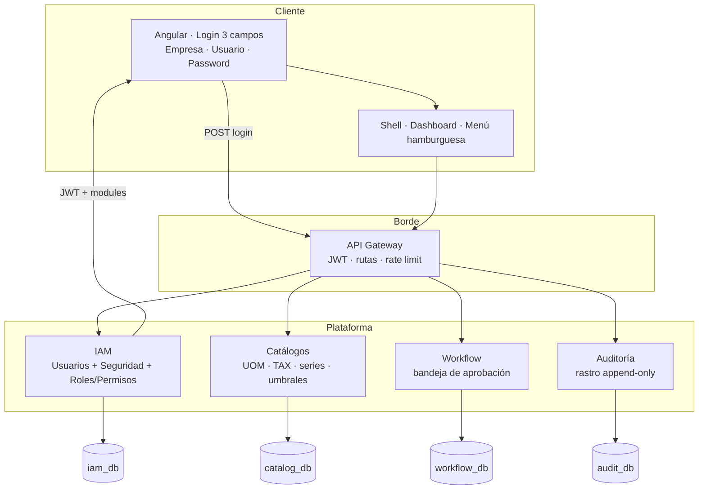
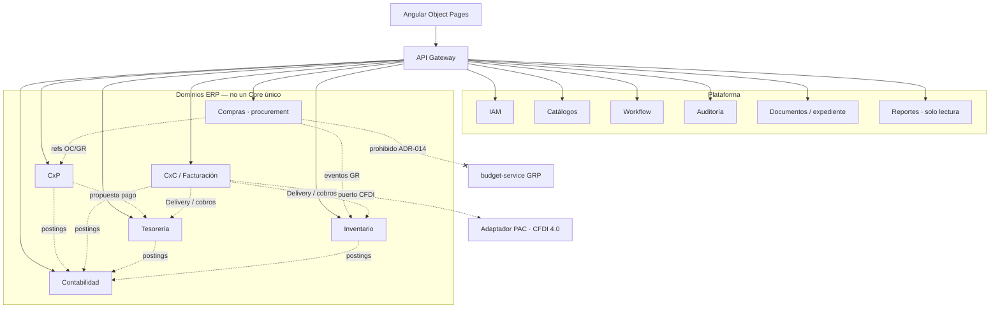
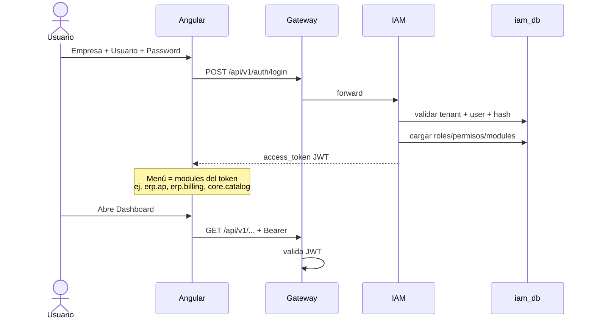

# Diagrama de microservicios por fases
## ERP-ARCH-DIAG-001

| Campo | Valor |
|-------|--------|
| Documento | ERP-ARCH-DIAG-001 |
| Propósito | Validar el mapa de servicios **antes** de desarrollar |
| Alineado a | ERP-MS-001 · ADR-014 · login 3 campos (empresa/usuario/password) |

---

## 1. Vista rápida — dos momentos

```text
FASE A (arranque)          FASE B (ERP dominio)
─────────────────          ────────────────────
Browser / Angular          + Compras
    │                      + Inventario
    ▼                      + CxP
 API Gateway               + CxC / Facturación (+ puerto CFDI)
    │                      + Contabilidad
    ├─ IAM (usuarios+seg)  + Tesorería
    ├─ Catálogos           + Documentos
    ├─ Workflow            + Reportes (lectura)
    └─ Auditoría
```

---

## 2. Fase A — Login y shell (probar en línea)

Solo lo necesario para: **empresa + usuario + password** → JWT → menú por permisos.



**Permisos:** el admin (dentro de IAM) asigna a cada usuario qué módulos ve (Catálogos, Facturación, CxC…). El login **no** pide rol.

---

## 3. Fase B — Dominios ERP (sin un solo “Core” dios)

Cada caja = microservicio + su propia BD. El Gateway sigue siendo la puerta.



---

## 4. Flujo de login (detalle)



---

## 5. Comparación: “Core único” vs mapa sugerido

| Enfoque | Riesgo | Recomendación |
|---------|--------|---------------|
| Un microservicio Core con todo el ERP | Deploy/fallo total; SoD débil; BD compartida | **Evitar** |
| Plataforma + dominios (este diagrama) | Más repos/servicios, pero límites claros | **Usar** |
| Empezar solo Fase A y luego Compras | Entrega incremental testeable | **Camino feliz** |

---

## 6. Orden de construcción (recordatorio)

1. Gateway + IAM + seed admin + login 3 campos  
2. Catálogos + menú dinámico + dashboard vacío/KPIs stub  
3. Workflow + Auditoría  
4. Compras → Inventario → CxP → Tesorería → Ventas/AR → CFDI → Contabilidad → Reportes/Documentos  

---

**Fin ERP-ARCH-DIAG-001**
