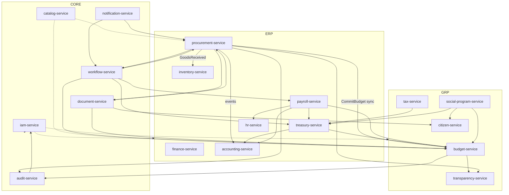

# 2. Mapa de servicios y dependencias
## SA-MS-001

## 2.1 Diagrama lógico

## 2.2 Matriz de dependencias runtime (resumen)

| Servicio | Depende de (sync) | Depende de (events) |
|----------|-------------------|---------------------|
| iam-service | Redis, DB | — |
| audit-service | DB, ES | casi todos |
| catalog-service | DB, Redis | tenant seed |
| workflow-service | DB, IAM, Rules | document, budget responses |
| notification-service | DB, providers | workflow/domain events |
| document-service | DB, Object Storage | workflow signature requests |
| procurement-service | IAM, WF, **budget**, DOC, CAT | WF outcomes, budget events |
| budget-service | IAM, WF, CAT, DOC | procurement/treasury/payroll |
| accounting-service | IAM | procurement/treasury/payroll/inventory |
| treasury-service | IAM, WF, budget | invoices/payroll/tax |
| inventory-service | IAM | goods received |
| hr-service | IAM, WF, DOC | — |
| payroll-service | IAM, WF, hr, budget | — OUT-F1 |
| transparency-service | IAM, DOC | budget/procurement |
| citizen-service | IAM, WF, DOC | OUT-F1 |
| social-program-service | IAM, budget, treasury, citizen | OUT-F1 |
| tax-service | IAM, treasury, DOC | OUT-F1 |
| finance-service | IAM, CAT | F2+ |

## 2.3 Anti-dependencias (límites)

| Prohibido | Motivo |
|-----------|--------|
| budget-service → procurement DB | Rompe ownership de P2P |
| procurement-service → update allocation rows directo | Rompe funds control |
| *-service → enviar SMTP propio | Bypass notification-service |
| *-service → guardar PDFs locales sin document-service | Bypass EDM/hash/retención |
| accounting-service → ejecutar pagos | Tesorería es dueña de caja |
| Core → ERP/GRP compile-time | Impide módulos on/off |
