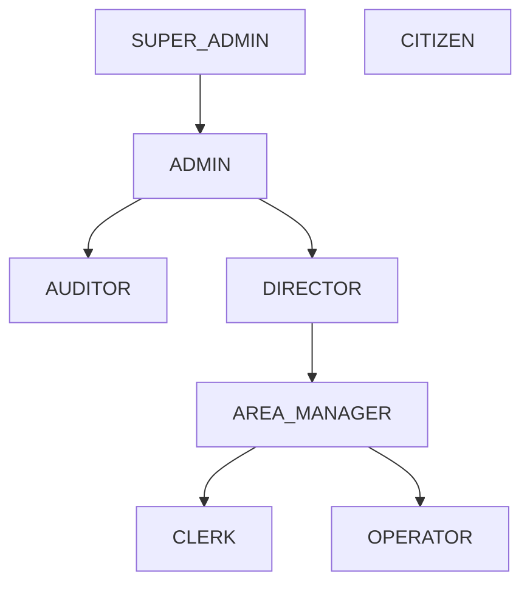

# Modelo de Roles

## Roles de plataforma
| Rol | Código | Alcance | Descripción |
|-----|--------|---------|-------------|
| Super Administrador | `SUPER_ADMIN` | Global | Tenants, licencias, break-glass |
| Administrador | `ADMIN` | Tenant | Usuarios, roles, módulos, catálogos |
| Auditor | `AUDITOR` | Tenant (read) | Trails, reportes de control |
| Director | `DIRECTOR` | Tenant/OU | Aprobaciones de alto nivel, dashboards |
| Jefe de Área | `AREA_MANAGER` | OU | Aprobaciones operativas |
| Capturista | `CLERK` | OU/módulo | Alta de transacciones |
| Operador | `OPERATOR` | OU/módulo | Operación rutinaria |
| Ciudadano | `CITIZEN` | Self | Portal externo, propios trámites |

## Roles funcionales (ejemplos)
- `FIN_ANALYST`, `ACC_ACCOUNTANT`, `TRE_PAYMASTER`
- `BUD_ANALYST`, `BUD_APPROVER`
- `PRC_BUYER`, `PRC_COMMITTEE`
- `HR_OFFICER`, `PAY_ANALYST`
- `TAX_COLLECTOR`, `CIT_AGENT`

## Jerarquía

Los roles **no heredan permisos automáticamente** salvo políticas explícitas (evita privilege creep de ERP legacy).
