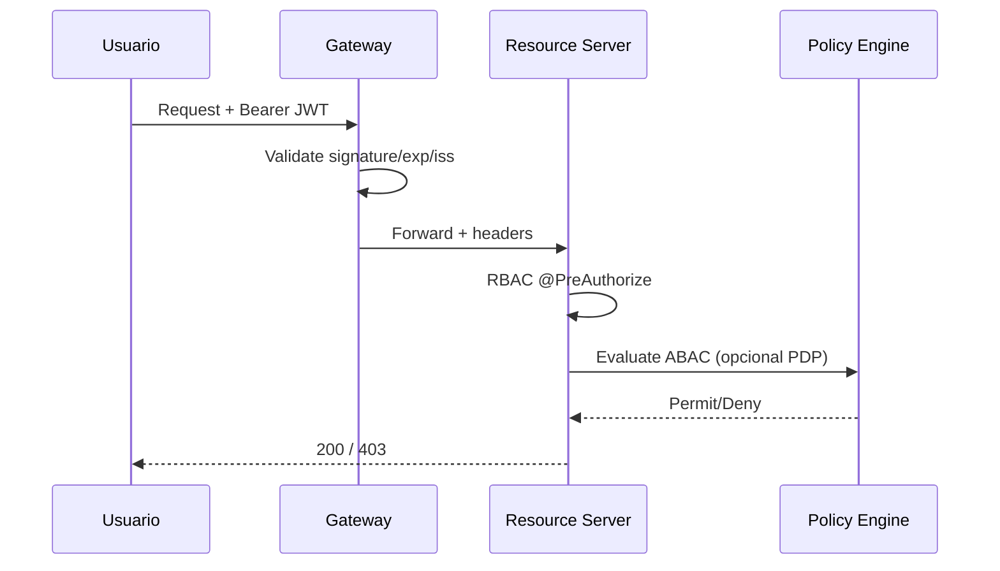

# Autorización RBAC + ABAC

## Flujo


## Atributos ABAC
- Sujeto: roles, clearance, ou, employeeId
- Recurso: tenantId, module, amount, costCenter, budgetItem
- Acción: create/approve/execute/export
- Entorno: ipRange, timeWindow, deviceTrust, mfaAge

## Ejemplo política
```json
{
  "id": "budget-approve-high",
  "effect": "Permit",
  "actions": ["budget.allocation:approve"],
  "condition": "subject.roles.contains('BUD_APPROVER') && resource.amount <= subject.approvalLimit && resource.tenantId == subject.tenantId && environment.mfaAge < 300"
}
```
