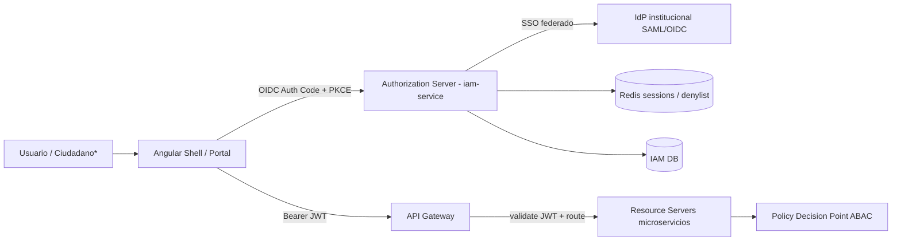

# 1. Arquitectura IAM
## OAuth2 · OpenID Connect · JWT · MFA · SSO

## 1.1 Vista de referencia

\*Ciudadano fuera de Fase 1; el diseño lo contempla como client/realm separado.

## 1.2 OAuth 2 / OIDC

| Elemento | Decisión |
|----------|----------|
| Roles OAuth | `iam-service` = Authorization Server + OpenID Provider |
| Microservicios | Resource Servers (JWT) |
| Shell Angular | Public client — **Authorization Code + PKCE** |
| Integraciones M2M | Confidential clients — **Client Credentials** |
| Portal ciudadano (futuro) | Cliente OIDC separado, scopes mínimos |
| Scopes base | `openid profile`, `erp.read`, `erp.write`, `grp.read`, `grp.write`, `audit.read`, `admin` |
| Refresh | Rotación de refresh tokens; reuse detection → revocar familia |

**Justificación:** alineado a Spring Authorization Server / Entra ID / SAP IAS: un IdP, apps como RS, PKCE obligatorio en SPA.

### Flujos permitidos
- Authorization Code + PKCE (humanos)
- Client Credentials (servicios)
- Token Exchange (opcional, step-up / impersonation auditada — break-glass)

### Flujos prohibidos
- Implicit
- Password grant (Resource Owner)
- Tokens en localStorage sin mitigaciones (preferir memoria + refresh en cookie segura httpOnly si BFF)

## 1.3 JWT

| Claim | Uso |
|-------|-----|
| `sub` | userId |
| `tenant_id` | aislamiento multi-tenant |
| `preferred_username` | UX / auditoría |
| `roles` | RBAC grueso |
| `permissions` | opcional (o resolución en PDP/RS) |
| `org_scopes` | lista de alcances OU/LE |
| `modules` | módulos activos del tenant ∩ usuario |
| `amr` | métodos auth (`pwd`, `otp`, `hwk`) |
| `mfa` | boolean / level |
| `sid` | sesión para revocación |
| `exp` / `iat` / `iss` / `aud` | estándar |

**Parámetros:** RS256/ES256, access TTL 5–15 min, JWKS en `/oauth2/jwks`, `aud` por API.

**Justificación de no meter todos los permisos finos en JWT:** evita tokens enormes; el RS valida rol+scope y consulta PDP para ABAC de monto/SoD.

## 1.4 MFA

| Capacidad | Decisión |
|-----------|----------|
| Métodos | TOTP (default), WebAuthn opcional, OTP SMS solo fallback |
| Enrollment | Obligatorio para `ADMIN`, `SUPER_ADMIN`, `TRE_PAYMASTER`, `BUD_APPROVER`, `DIRECTOR` |
| Step-up | Reexigir MFA si `amr` no incluye otp/hwk y la acción es sensible |
| Acciones step-up | pagos, adjudicaciones, cierre de periodo, export masivo PII, grant `TENANT_ALL`, modificar partidas sobre umbral |
| Lockout | N fallos MFA → lock temporal + audit |

## 1.5 SSO

| Modo | Uso |
|------|-----|
| SSO local de plataforma | Sesión única entre Shell ERP/GRP |
| SSO federado | IdP municipal/estatal (OIDC/SAML) |
| JIT provisioning | Alta/actualización de usuario al primer login federado |
| SLO | Back-channel logout + revocación `sid` |

**Justificación piloto municipal:** funcionarios suelen tener IdP institucional; la plataforma no debe forzar otra contraseña salvo break-glass local.

## 1.6 Multi-tenant + tenant dedicado

- Claims siempre llevan `tenant_id`.  
- Runtime dedicado: un solo tenant en el cluster, **pero** el modelo de seguridad no asume mono-tenant (pruebas de aislamiento obligatorias).  
- Gateway rechaza tokens de tenant ≠ ruta/contexto.

## 1.7 Controles de plataforma

| Control | Mecanismo |
|---------|-----------|
| Rate limit login | Redis por IP + username |
| Denylist | `sid` / jti en Redis |
| Secrets | Vault / KMS — nunca en Git |
| Transport | TLS 1.2+ / 1.3 |
| mTLS interno | Service mesh (fase madurez) |
| Auditoría auth | Éxitos/fallos/MFA/lock → Audit BC |
